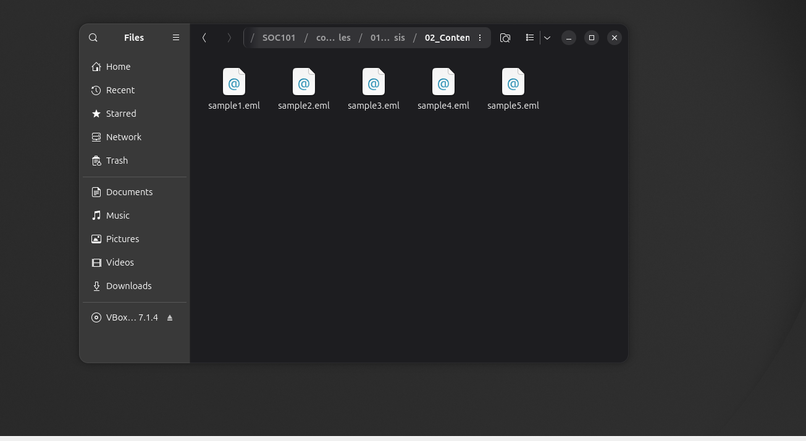
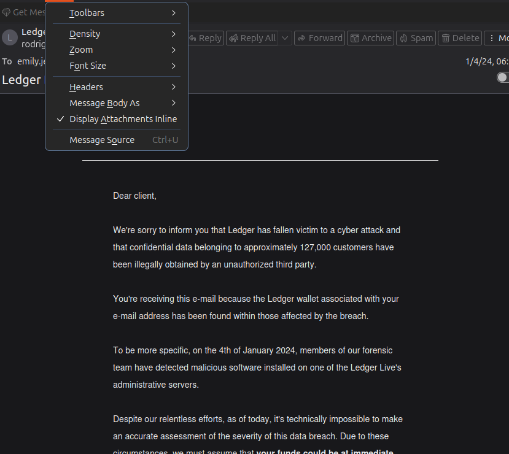
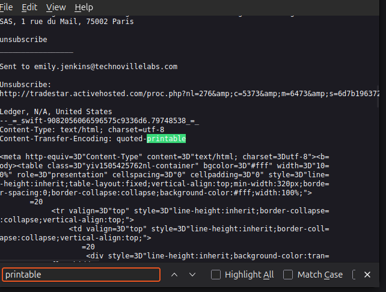
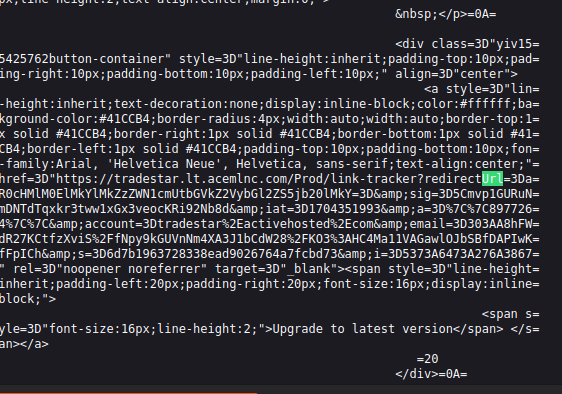
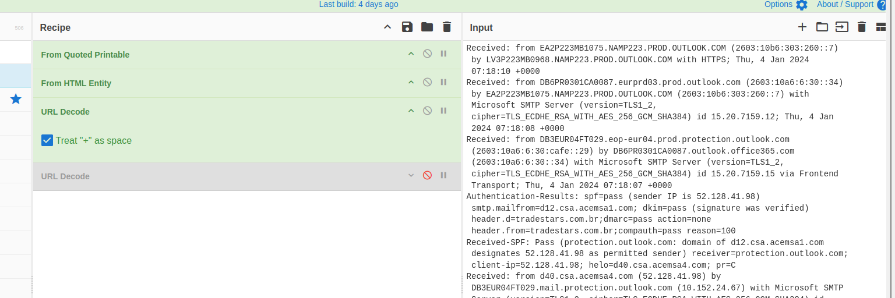
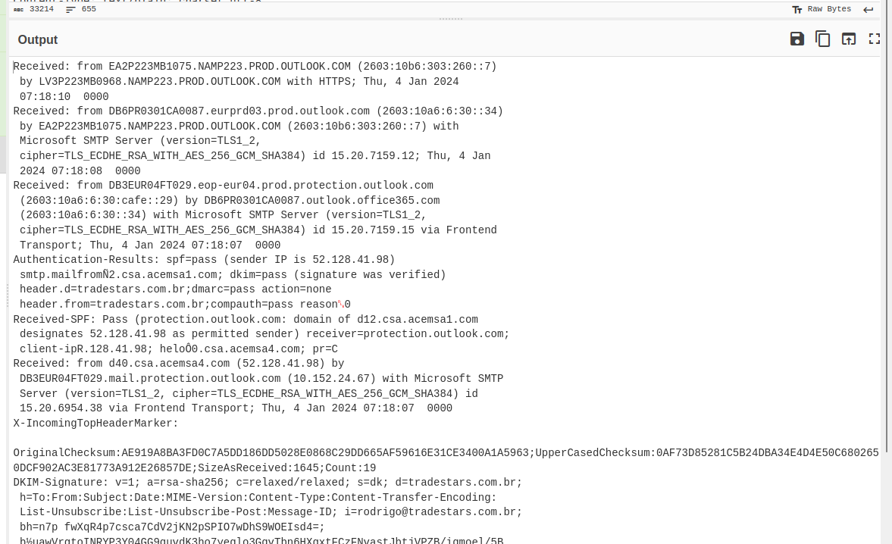

# Decoding Email Content, Part 1: Quoted-Printable (sample5.eml)

*Locate and decode an embedded URL in a sample message*

| | |
| --- | --- |
| **Format** | Series, part 1 of 2. Continues in [Decoding Email Content, Part 2: MIME and Base64 (sample1.eml)](email-content-decoding-part-2-mime-and-base64.md) |
| **Category** | Email analysis, phishing |

## Objective

Locate and decode a URL hidden inside the quoted-printable HTML of a phishing email (`sample5.eml`, from the `02_Content_Analysis` folder).

## Tools used

| Tool | Purpose |
| --- | --- |
| Thunderbird | Open the message and view its source |
| CyberChef | Decode the quoted-printable text and the URL |

## Methodology

### 01 Open the sample file

*Open sample5.eml from the sample folder.*

### 02 Inspect the message source

*In the email client, open the message menu and select “Message Source.”*

### 03 Find the quoted-printable section

*Search the source for “printable” to locate the quoted-printable content.*

### 04 Locate the encoded URL

*Identify the URL within the encoded HTML content.*

### 05 Load the recipe in CyberChef

*Use the recipe shown to decode the message content.*

### 06 Review the decoded output

*The output displays the decoded message content.*

## Commands and explanations

| Command or action | What it does |
| --- | --- |
| View, Message Source (`Ctrl+U`) | Shows the raw HTML of the message |
| Search the source for `printable` | Finds the `Content-Transfer-Encoding: quoted-printable` header |
| CyberChef recipe: From Quoted Printable, From HTML Entity, URL Decode (Treat "+" as space) | Undoes the three layers of encoding that make the link unreadable |

## Findings

- The message is a fake data-breach notice presented as a message from a crypto-wallet company.
- The call-to-action link is wrapped in a **click-tracking URL** (`tradestar.lt.acemlnc.com/Prod/link-tracker?redirectUrl=...`) with the real destination stored in an encoded `redirectUrl` parameter.
- The link is encoded in three layers (quoted-printable, HTML entities, URL encoding). The CyberChef recipe removes all three and exposes the readable text.
- The decoded text also exposes the original headers. Authentication passes for domains that belong to the sending platform, not to the brand the message claims to represent.

## Mitigations

- Do not click tracked links in unexpected security notices. Go to the official site by typing its address instead.
- Decode and defang links, then check them in a sandbox or URL scanner before judging them.
- Use a mail gateway that rewrites and detonates URLs at click time.
- Report breach-notification lures to the security team so similar messages can be searched for and removed.

## Lessons learned

- Encodings can be stacked. If the output still looks wrong, decode again.
- Tracking and redirect parameters hide the final destination, so decode them before deciding where a link leads.
- A message can pass authentication and still be a scam.

---

**Next:** [Decoding Email Content, Part 2: MIME and Base64 (sample1.eml)](email-content-decoding-part-2-mime-and-base64.md)
