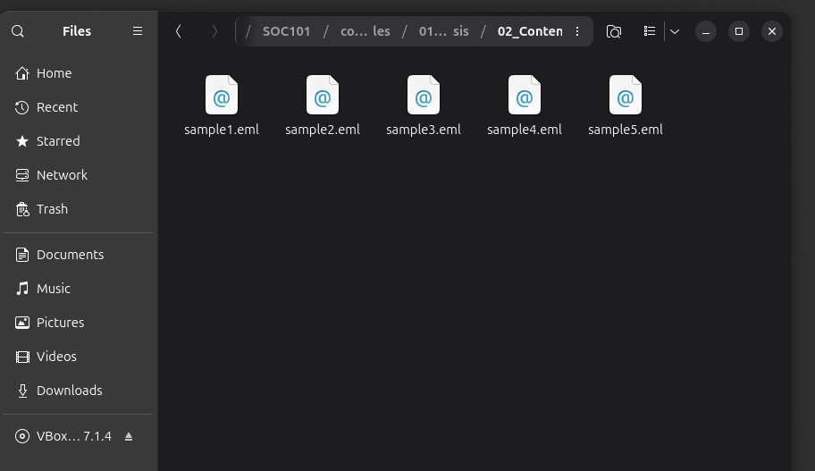
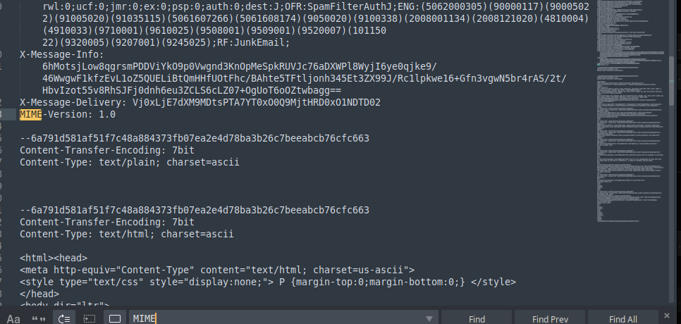
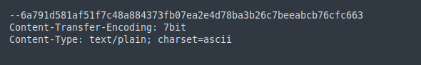
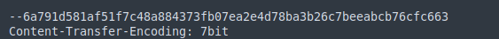
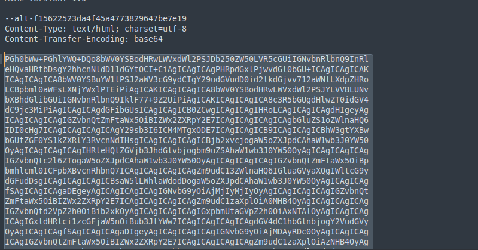
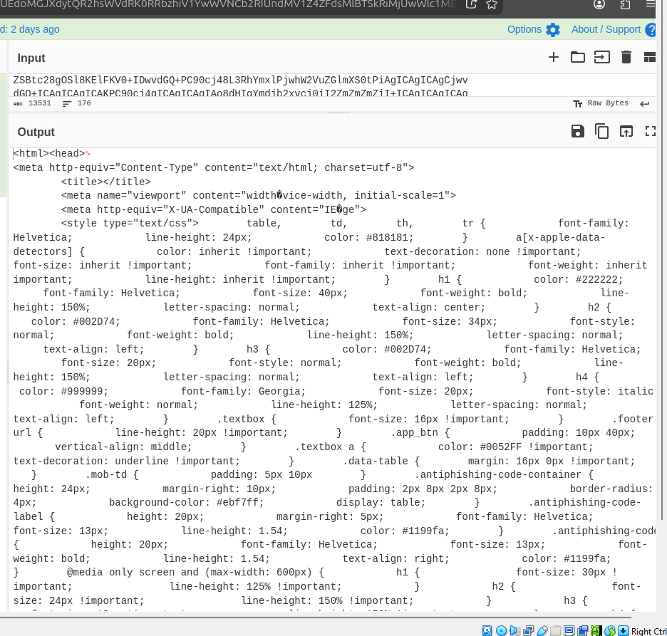
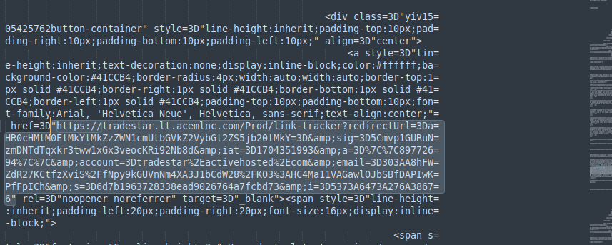
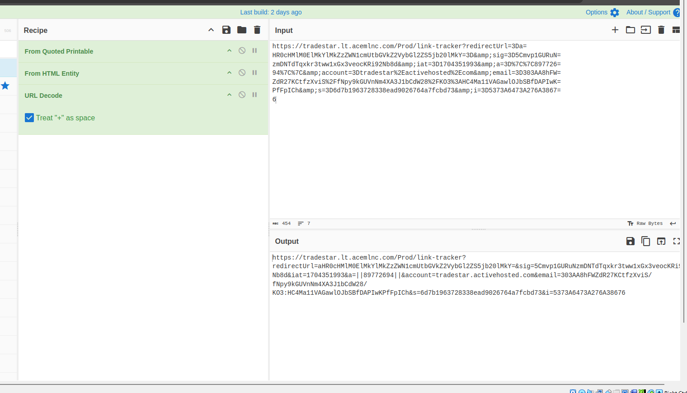

# Decoding Email Content, Part 2: MIME and Base64 (sample1.eml)

*Understanding MIME parts and decoding Base64 content to recover a URL*

| | |
| --- | --- |
| **Format** | Series, part 2 of 2. Continues from [Decoding Email Content, Part 1: Quoted-Printable (sample5.eml)](email-content-decoding-part-1-quoted-printable.md) |
| **Category** | Email analysis, phishing |

## Objective

Learn how a MIME message is split into parts, recognize each part's transfer encoding, and decode a Base64 HTML body to read what the recipient would see. The final steps return to the tracking link from Part 1 and decode it completely.

## Tools used

| Tool | Purpose |
| --- | --- |
| Thunderbird | Open the message as a user would see it |
| Sublime Text | Read the raw MIME structure and search it |
| CyberChef | Decode Base64 content and the encoded URL |

## Methodology

### 01 Open the sample

*`sample1.eml` in the `02_Content_Analysis` folder, opened in Thunderbird and Sublime Text.*

### 02 Find the MIME version

*Searching for `MIME` finds `MIME-Version: 1.0`. MIME lets one email carry plain text, HTML, images and attachments together.*

### 03 Identify the MIME boundaries

*Each part starts with the boundary string (`--6a791d58...`) followed by its own `Content-Type` header.*

### 04 Check the transfer encoding

*The plain-text and HTML alternatives are sent as `7bit`, so they can be read without decoding.*

### 05 Copy the Base64 part

*A `text/html` part with `Content-Transfer-Encoding: base64`. The whole Base64 block is copied for decoding.*

### 06 Decode it in CyberChef

*From Base64 turns the block back into readable HTML: the styling and layout of the message body.*

### 07 Copy the tracking URL

*Back in the quoted-printable message from Part 1, the full `href` of the call-to-action button is selected.*

### 08 Decode the URL

*From Quoted Printable, From HTML Entity and URL Decode give a readable `link-tracker` URL. Its `redirectUrl` parameter is still encoded.*

## Commands and explanations

| Command or action | What it does |
| --- | --- |
| Search the source for `MIME` | Finds the MIME version and the start of the multipart structure |
| Search for the boundary string | Separates the message into its parts |
| Read each part's `Content-Transfer-Encoding` | Shows whether the part is `7bit`, `quoted-printable` or `base64` |
| CyberChef: From Base64 | Decodes a Base64 body back to HTML |
| CyberChef: From Quoted Printable, From HTML Entity, URL Decode | Removes the three encoding layers around the tracking link |

## Findings

- `sample1.eml` is a `multipart` message whose parts use different encodings: `7bit` for the plain alternatives and `base64` for an HTML body.
- Base64 hides the HTML from simple keyword filters and from anyone skimming the source. The decoded body includes styles for an `antiphishing-code` block, which imitates the security codes real services show to look trustworthy.
- The button in the Part 1 message links to `tradestar.lt.acemlnc[.]com/Prod/link-tracker`, a mail-marketing click tracker.
- The `redirectUrl` value is itself Base64 (`aHR0cHM...`, which decodes to `https...`). Decoding it shows the real destination, `hxxps://secure-ledgerlive[.]com/`. This is a lookalike of the wallet brand the message impersonates.

## Mitigations

- Make sure the mail gateway decodes every MIME part, including Base64 HTML, before scanning it.
- Rewrite URLs at the gateway and follow redirects at click time so tracker-wrapped links are checked against their final destination.
- Block lookalike domains of brands your users rely on, and report them to the brand owner.
- Teach users to hover over buttons and treat tracking or redirect links in security alerts with suspicion.

## Lessons learned

- Read each MIME part's headers before decoding. The `Content-Transfer-Encoding` tells you which CyberChef operation to use.
- Encodings are often nested: quoted-printable, then HTML entities, then URL encoding, then Base64 inside a parameter. Keep decoding until the output stops changing.
- A link-tracking domain is not the destination. The real target is usually in a parameter.

---

**Previous:** [Decoding Email Content, Part 1: Quoted-Printable (sample5.eml)](email-content-decoding-part-1-quoted-printable.md)
