# Email Header Analysis, Part 1: Lab Setup and Raw Headers

*Environment setup, raw-message inspection, sender IP and WHOIS lookup*

| | |
| --- | --- |
| **Format** | Series, part 1 of 2. Continues in [Email Header Analysis, Part 2: SPF, DKIM and DMARC Results (sample3.eml)](email-header-analysis-part-2-spf-dkim-dmarc.md) |
| **Category** | Email analysis, phishing |

## Objective

Prepare an analysis workstation and examine the headers of a suspicious message (`sample1.eml`, from the `01_Header_Analysis` folder). The goal is to trace the delivery path, identify the sending IP, find out who owns it, and compare that with what the message claims to be.

## Tools used

| Tool | Purpose |
| --- | --- |
| Thunderbird | Open `.eml` files the way a user would see them |
| Sublime Text (with Package Control) | Read the raw message source with syntax highlighting and search |
| Terminal (`cat`, `whois`) | Print the raw message and look up IP ownership |
| MXToolbox Email Header Analyzer | Parse the headers, check authentication and chart the relay path |

## Methodology

### 01 Install Thunderbird

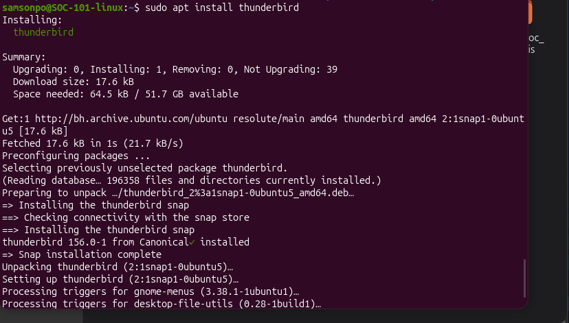

*Thunderbird installed from the terminal with `sudo apt install thunderbird`.*

### 02 Launch Thunderbird

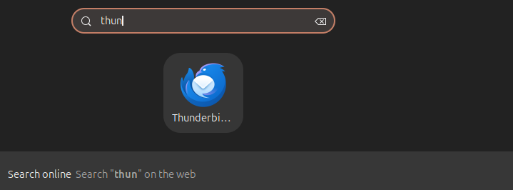

*Finding Thunderbird from the desktop search.*

### 03 Allow remote content (lab only)

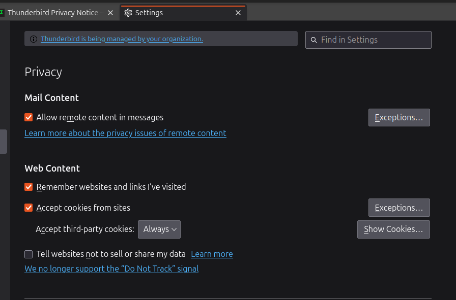

*Privacy settings with "Allow remote content in messages" enabled so the sample renders fully.*

> **Note:** Remote content can tell a sender that a message was opened and pulls in external resources. Only enable it on an isolated analysis machine.

### 04 Install Sublime Text

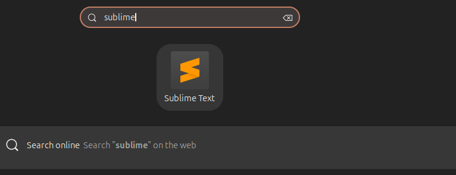

*Sublime Text installed and available from the desktop search.*

### 05 Open the header-analysis workspace

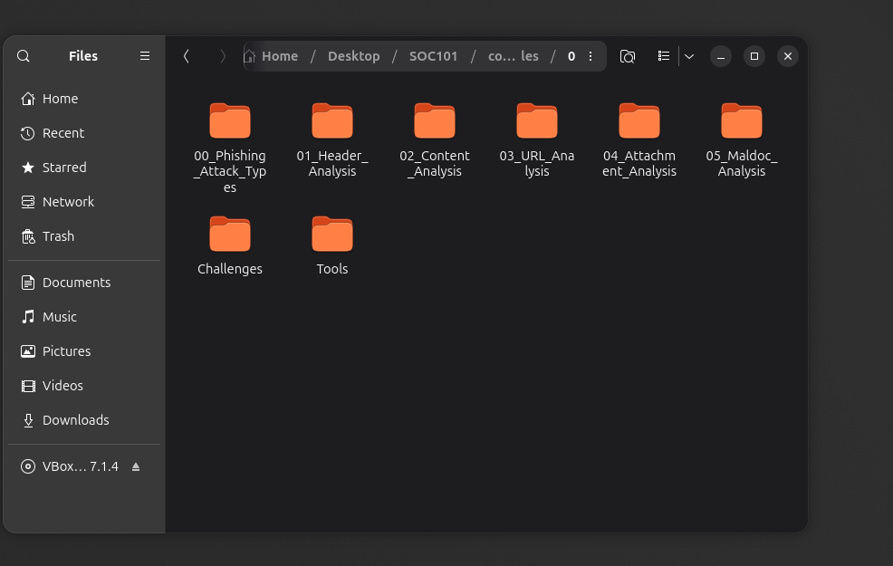

*The course folders, with `01_Header_Analysis` holding the samples for this exercise.*

### 06 Locate the samples

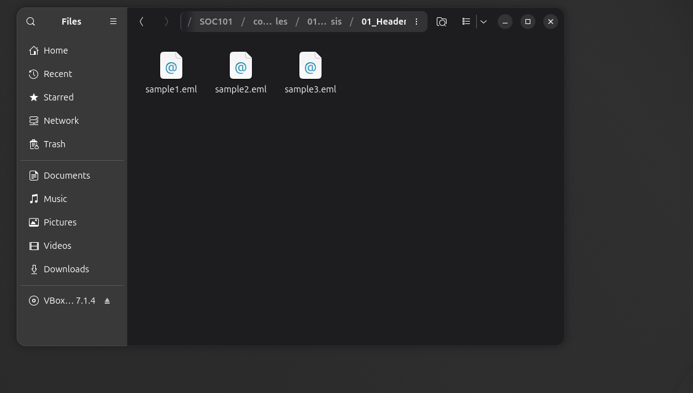

*Three samples are available: `sample1.eml`, `sample2.eml` and `sample3.eml`.*

### 07 Open sample1.eml in Sublime Text

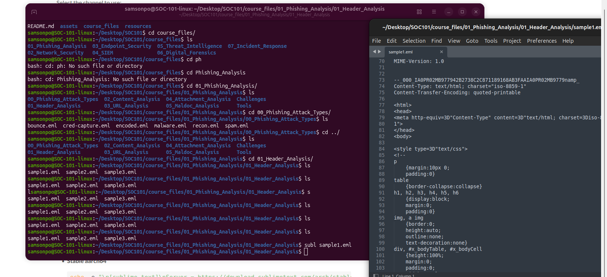

*Navigating to the folder in the terminal and opening the sample with `subl sample1.eml`.*

### 08 Print the raw message in the terminal

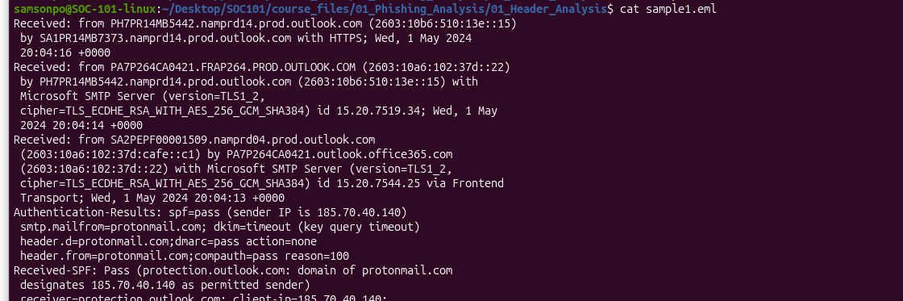

*`cat sample1.eml` shows the unformatted headers: the `Received` chain, `Authentication-Results` and `Received-SPF`.*

### 09 Install Package Control

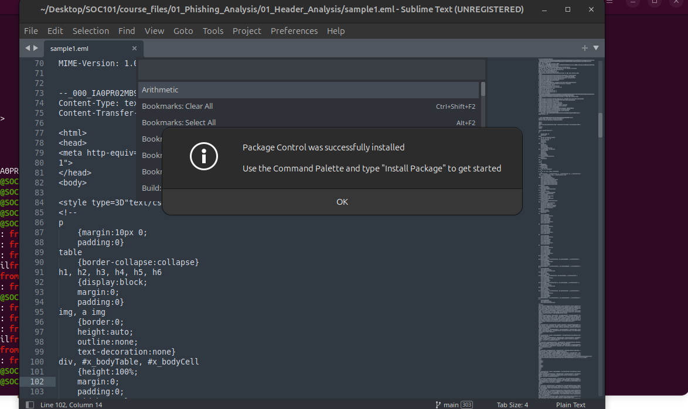

*Package Control installed from the Command Palette (`Ctrl+Shift+P`) so extra syntax packages can be added.*

### 10 Identify the sender IP

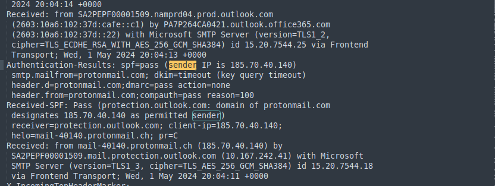

*The first external hop: `Received: from mail-40140.protonmail.ch (185.70.40.140)`. SPF passes for `protonmail.com`.*

### 11 Look up the IP with WHOIS

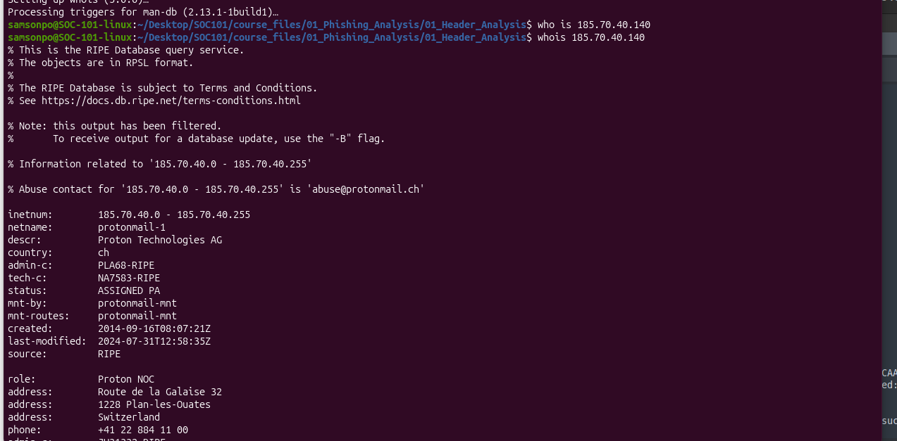

*`whois 185.70.40.140` returns the `protonmail-1` network, owned by Proton Technologies AG in Switzerland.*

### 12 Analyze the header in MXToolbox

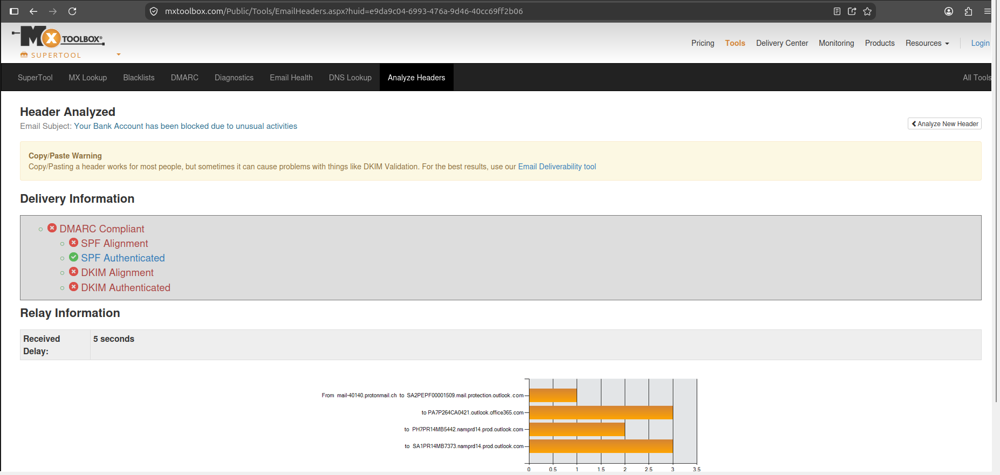

*MXToolbox shows the subject "Your Bank Account has been blocked due to unusual activities" and fails DMARC compliance, SPF alignment and DKIM for the visible sender.*

### 13 Review the relay path

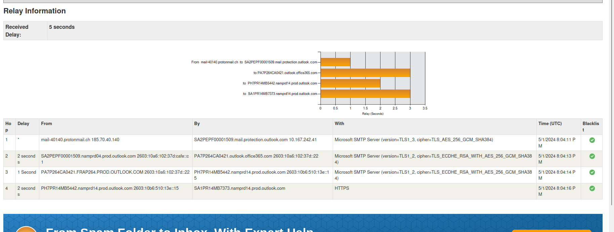

*Four hops from `mail-40140.protonmail.ch` through Microsoft's Outlook servers, delivered in about 5 seconds with no blocklist hits.*

## Commands and explanations

| Command or action | What it does |
| --- | --- |
| `sudo apt install thunderbird` | Installs the Thunderbird mail client |
| `subl sample1.eml` | Opens the raw message in Sublime Text |
| `cat sample1.eml` | Prints the raw message to the terminal |
| `Ctrl+Shift+P`, Install Package Control | Adds the Sublime Text package manager |
| `whois 185.70.40.140` | Shows who the IP address is registered to |
| MXToolbox, Analyze Headers | Parses the headers and checks SPF, DKIM, DMARC and the relay path |

## Findings

- The message is a bank account-suspension notice, a classic credential-phishing lure. Its visible sender is `alerts@chase.com`.
- The real origin is **185.70.40.140** (`mail-40140.protonmail.ch`), a Proton Mail server. WHOIS confirms the range belongs to Proton Technologies AG.
- SPF and DMARC pass, but only for `protonmail.com` (`header.from=protonmail.com`), the free mail service the attacker used. That does not match the bank domain in the visible `From` field, which is a strong sign of spoofing.
- DKIM returned `timeout (key query timeout)`, so the signature could not be verified.
- MXToolbox marks the message as **not DMARC compliant** for the displayed sender, with SPF and DKIM not aligned.
- The relay path is short and clean (Proton to Microsoft 365). This is normal for a message sent from a free webmail account.

## Mitigations

- Flag messages where the display name or brand does not match the sending domain, especially from free webmail providers.
- Enforce DMARC (`p=reject` or `p=quarantine`) on your own domains so they cannot be spoofed.
- Train users to check the real sender address, not only the display name.
- Feed confirmed phishing senders and IPs back into the mail gateway's blocklists.

## Lessons learned

- The first `Received` header added by your own mail system is the most reliable record of who connected. Read the chain from bottom to top.
- SPF, DKIM and DMARC "pass" only proves the message came from the domain it claims at the protocol level, not from the organization in the body.
- A lab environment needs care: settings like remote content are useful for analysis and risky on a daily-use machine.

---

**Next:** [Email Header Analysis, Part 2: SPF, DKIM and DMARC Results (sample3.eml)](email-header-analysis-part-2-spf-dkim-dmarc.md)
