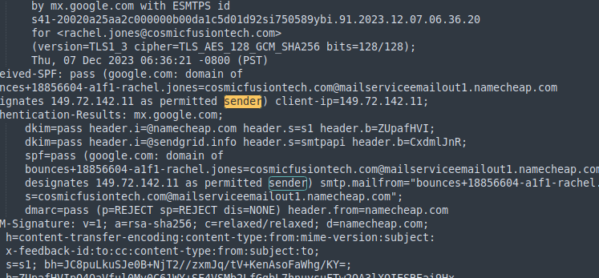
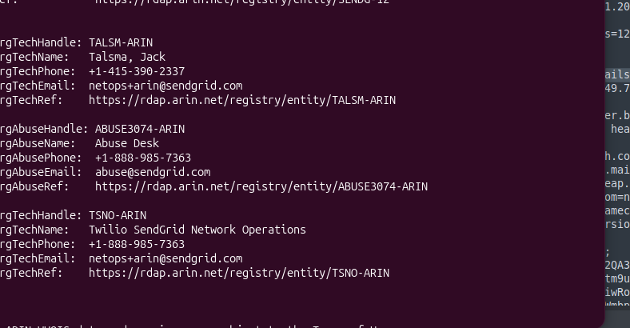
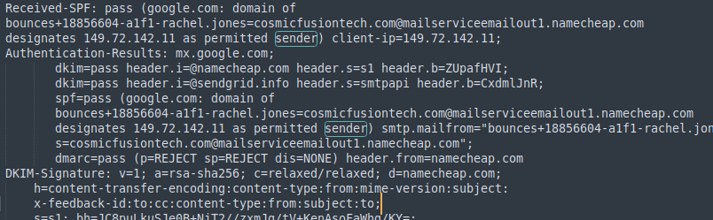
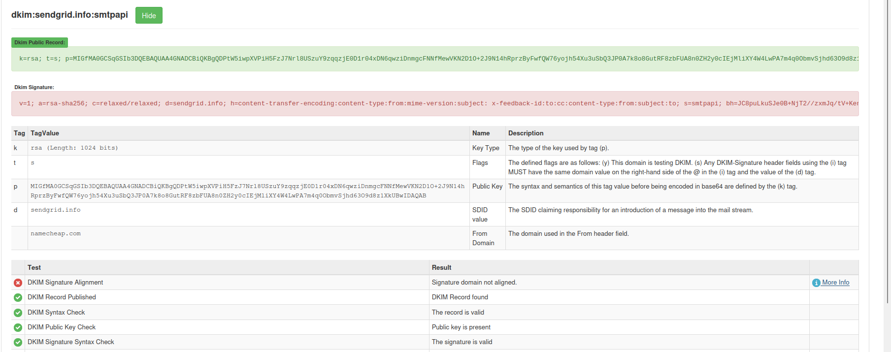
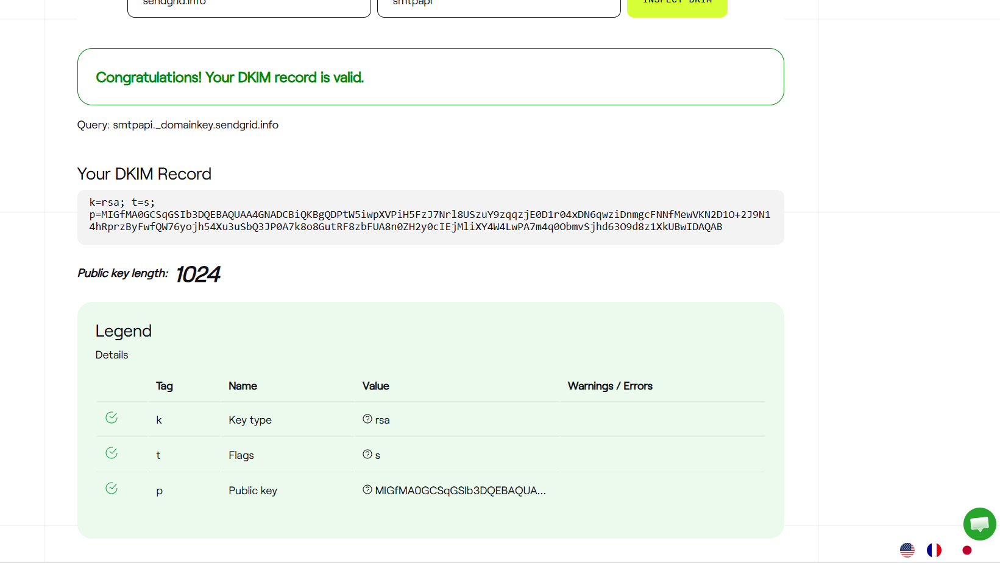

# Email Header Analysis, Part 2: SPF, DKIM and DMARC Results (sample3.eml)

*Reading authentication results and DKIM alignment in a real message header*

| | |
| --- | --- |
| **Format** | Series, part 2 of 2. Continues from [Email Header Analysis, Part 1: Lab Setup and Raw Headers](email-header-analysis-part-1-lab-setup-and-raw-headers.md) |
| **Category** | Email analysis, phishing |

## Objective

Review the authentication results in `sample3.eml` and decide what they do and do not prove. The message claims to come from `namecheap.com` and was delivered through SendGrid.

> **Scope:** This assessment is based on the headers and tool output captured below. Links, attachments and the business context of the message were not part of this exercise.

## Tools used

| Tool | Purpose |
| --- | --- |
| Sublime Text | Read the raw headers |
| `whois` | Identify who owns the sending IP |
| MXToolbox DKIM Lookup | Compare the DKIM signing domain with the visible `From` domain |
| DKIM record checker | Confirm the published DKIM public key is valid |

## Methodology

### 01 Read the raw headers

*Gmail's `Received-SPF` and `Authentication-Results` headers. The connecting IP is **149.72.142.11**.*

### 02 Identify the sending infrastructure

*`whois 149.72.142.11` returns contacts for Twilio SendGrid, a legitimate bulk email platform.*

### 03 Review the authentication results

*SPF passes for the SendGrid bounce address, DKIM passes for both `namecheap.com` and `sendgrid.info`, and DMARC passes for `namecheap.com` with policy `p=REJECT`.*

### 04 Check DKIM alignment

*MXToolbox reports "Signature domain not aligned" for the `d=sendgrid.info` signature, because it does not match the `From` domain `namecheap.com`.*

### 05 Validate the published DKIM record

*The record at `smtpapi._domainkey.sendgrid.info` is valid: an RSA key with a 1024-bit length.*

## Commands and explanations

| Command or action | What it does |
| --- | --- |
| Search the source for `Authentication-Results` | Finds the receiving server's SPF, DKIM and DMARC verdicts |
| `whois 149.72.142.11` | Shows who the sending IP is registered to |
| MXToolbox, DKIM Lookup (`sendgrid.info:smtpapi`) | Checks the signature against the `From` domain and the published key |
| DKIM record checker | Confirms the selector's DNS record exists and is well formed |

## Findings

| Check | Result | What it means |
| --- | --- | --- |
| Sender IP | 149.72.142.11 (SendGrid) | The message was sent through a legitimate email delivery platform |
| SPF | Pass | SendGrid is allowed to send for the envelope sender (`mailserviceemailout1.namecheap.com`) |
| DKIM `d=namecheap.com` | Pass, aligned | Signed by the same domain as the visible `From` |
| DKIM `d=sendgrid.info` | Pass, **not aligned** | Valid signature, but from the platform rather than the brand |
| DMARC | Pass (`p=REJECT`) | At least one mechanism passed and aligned with `namecheap.com` |
| DKIM record | Valid, 1024-bit RSA | The public key exists and is well formed |

**Verdict:** the message is technically authenticated for `namecheap.com`. That proves the domain authorized it to be sent. It does not prove the content or request is safe, so it still needs to be reviewed in context.

## Mitigations

- Treat authentication passes as one piece of evidence, not a final verdict on a message.
- Review links, attachments, the `Reply-To` address and the action being requested separately.
- Confirm unusual requests with the sender through a known, independent contact method.
- When reporting an alignment issue, name the exact signing domain (`d=sendgrid.info`) and keep it apart from the aligned signature.

## Lessons learned

- A message can carry more than one DKIM signature. Each must be checked for alignment on its own.
- DMARC needs only **one** aligned pass (SPF or DKIM). One unaligned signature does not make the message fail.
- Legitimate senders often use third-party platforms like SendGrid, so a platform IP on its own is not suspicious.
- A valid DKIM record shows the key is published correctly. It says nothing about intent.

---

**Previous:** [Email Header Analysis, Part 1: Lab Setup and Raw Headers](email-header-analysis-part-1-lab-setup-and-raw-headers.md)
