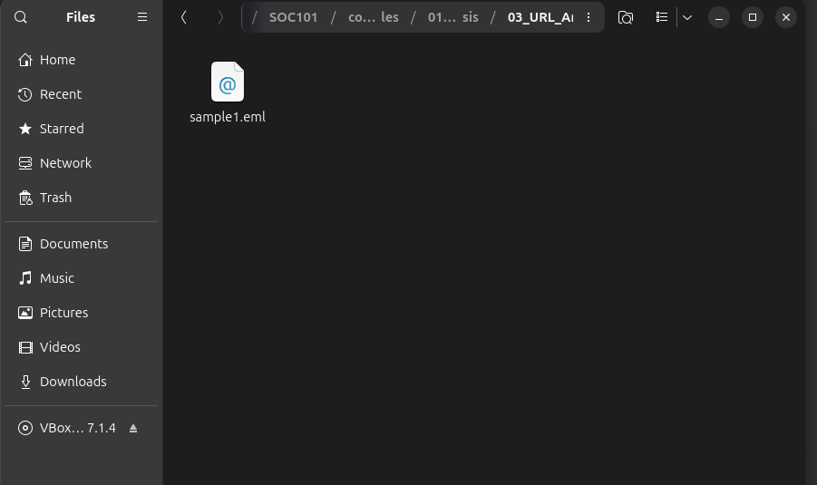
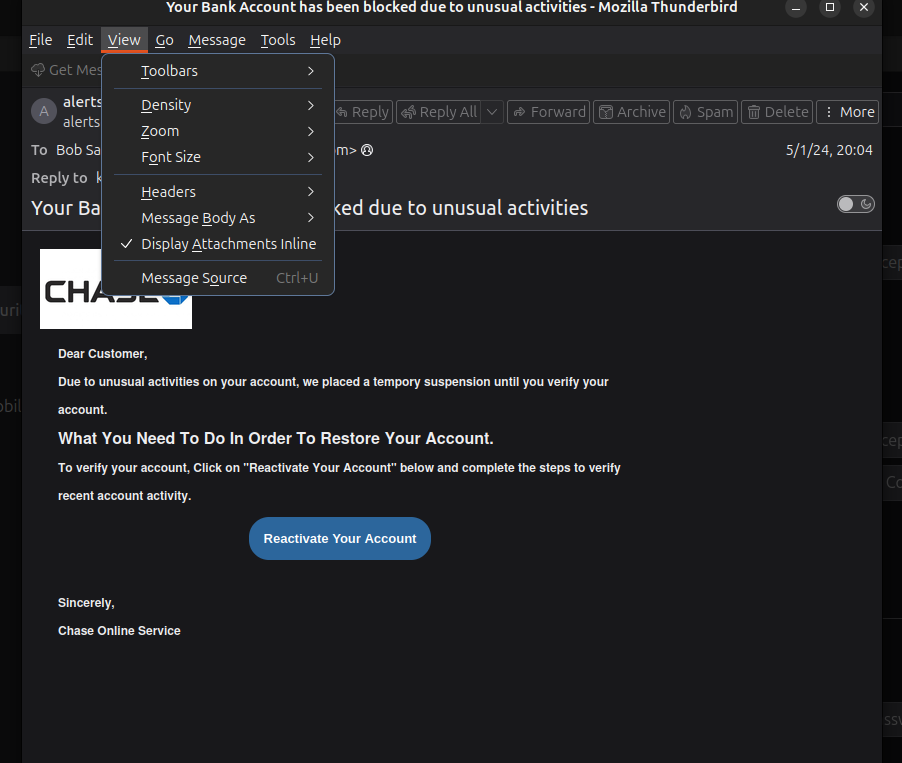
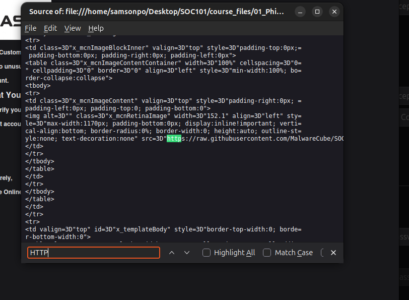
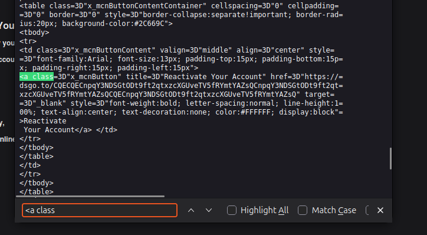
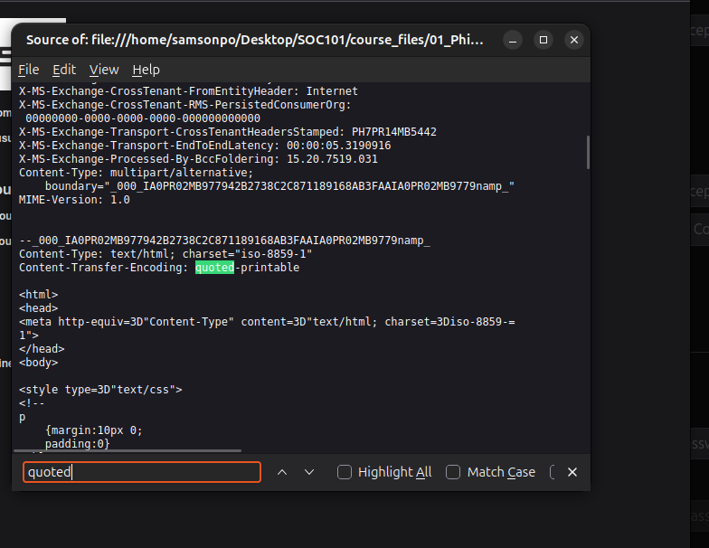
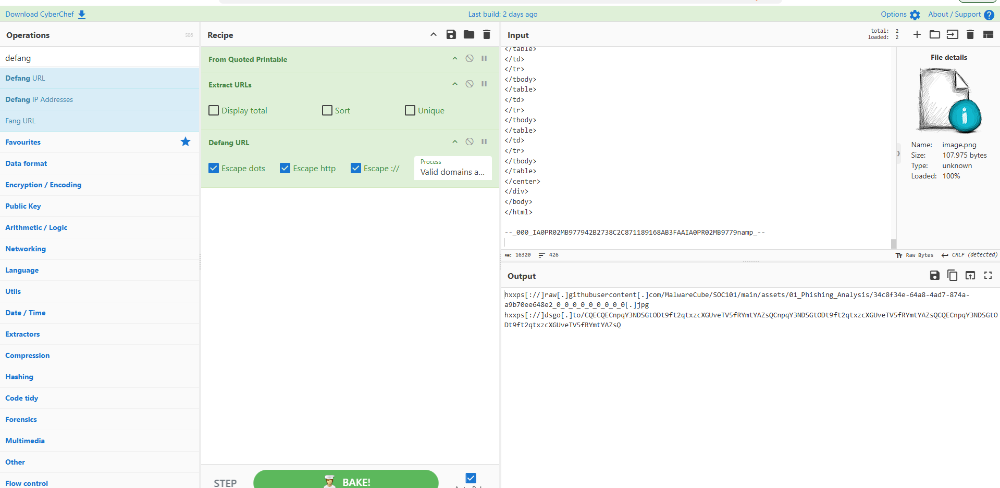
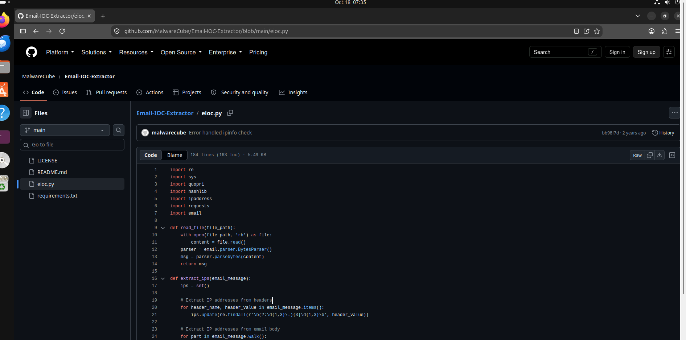
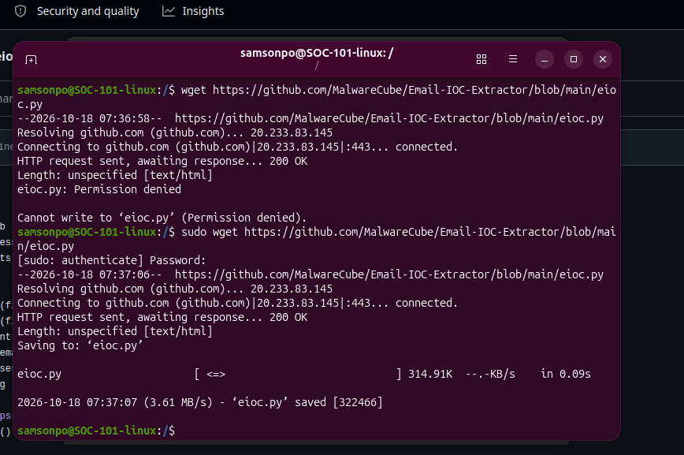
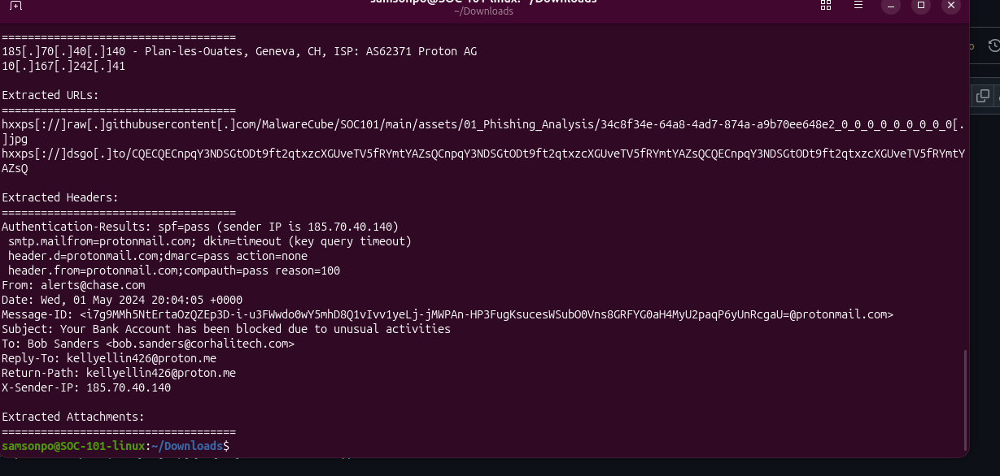

# Phishing Link Analysis, Part 1: Extracting URLs and IOCs

*Raw message source, CyberChef and the Email IOC Extractor*

| | |
| --- | --- |
| **Format** | Series, part 1 of 2. Continues in [Phishing Link Analysis, Part 2: Link Investigation Workflow](phishing-link-analysis-part-2-link-investigation-workflow.md) |
| **Category** | Email analysis, phishing |

## Objective

Extract every URL and indicator of compromise (IOC) from a suspicious email (`sample1.eml`, from the `03_URL_Analysis` folder) without clicking anything. The work is done three ways: by hand in the message source, with CyberChef, and with a script.

## Tools used

| Tool | Purpose |
| --- | --- |
| Thunderbird | Display the message and its raw source |
| CyberChef | Decode the body, extract URLs and defang them |
| Email IOC Extractor (`eioc.py`) | Pull IPs, URLs, headers and attachments out of an `.eml` in one pass |
| `wget` | Download the script to the analysis VM |

## Methodology

### 01 Locate the sample

*`sample1.eml` in the `03_URL_Analysis` folder.*

### 02 Open the message source

*The message claims to be from Chase and asks the user to "Reactivate Your Account". The source is opened from View, Message Source (`Ctrl+U`).*

### 03 Search for links

*Searching the source for `http` finds an image hosted on `raw.githubusercontent.com`.*

### 04 Find the call-to-action link

*The "Reactivate Your Account" button points to a `dsgo.to` short link. Line breaks and `=` signs from the encoding split the URL across lines.*

### 05 Check the content encoding

*`Content-Transfer-Encoding: quoted-printable` explains the broken lines and `=3D` sequences in the URLs.*

### 06 Extract and defang the URLs in CyberChef

*The recipe From Quoted Printable, Extract URLs and Defang URL produces two clean, non-clickable URLs.*

### 07 Find the IOC Extractor script

*The Email IOC Extractor project on GitHub. `eioc.py` uses Python's `email` parser to pull indicators from a message.*

### 08 Download the script

*The first `wget` failed with "Permission denied" because the current folder was `/`. It succeeded when re-run with `sudo`.*

### 09 Run the script

*`eioc.py` lists the sender IP with its location and ISP, the two defanged URLs and the key headers.*

## Commands and explanations

| Command or action | What it does |
| --- | --- |
| View, Message Source (`Ctrl+U`) | Shows the raw message, including headers and encoded HTML |
| Search the source for `http` and `<a class` | Finds embedded resources and the link behind each button |
| CyberChef: From Quoted Printable, Extract URLs, Defang URL | Decodes the body, lists every URL and makes each one safe to share |
| `wget https://raw.githubusercontent.com/MalwareCube/Email-IOC-Extractor/main/eioc.py` | Downloads the script (use the **raw** URL, not the `/blob/` page) |
| `python3 eioc.py sample1.eml` | Prints the IPs, URLs, headers and attachments found in the message |

## Findings

| Indicator | Value (defanged) |
| --- | --- |
| Display sender | `alerts@chase[.]com` |
| Reply-To and Return-Path | `kellyellin426@proton[.]me` |
| Sender IP | `185[.]70[.]40[.]140` (Proton AG, Geneva, CH) |
| Subject | Your Bank Account has been blocked due to unusual activities |
| Phishing link | `hxxps[://]dsgo[.]to/CQECQECnpqY3NDSGtODt9ft2qtxzcXGUveTV5fRYmtYAZsQ...` |
| Image host | `hxxps[://]raw[.]githubusercontent[.]com/MalwareCube/SOC101/...` (Chase logo) |
| Attachments | None |

- The message impersonates Chase, but replies go to a free Proton Mail address. That mismatch alone is a strong phishing signal.
- The real link is hidden behind a `dsgo.to` URL shortener, so the final destination cannot be seen from the email.
- The logo is loaded from a public file host instead of a Chase domain.

## Mitigations

- Flag messages where the `Reply-To` or `Return-Path` domain differs from the `From` domain.
- Expand short links at the gateway and check the final destination before delivery.
- Add the sender IP, reply address and short link to blocklists, and search the mailbox for other copies.
- Always defang indicators before putting them in tickets, chats or reports.

## Lessons learned

- Quoted-printable encoding breaks URLs across lines, so a plain search can miss them. Decode the source first.
- Doing the extraction by hand, in CyberChef and with a script cross-checks the result: all three found the same two URLs.
- Download scripts from the raw file URL. A GitHub `/blob/` URL returns the HTML page, not the code.
- Watch which folder you are in before writing files. Running `wget` in `/` caused the permission error, and moving to a working folder is safer than using `sudo`.

---

**Next:** [Phishing Link Analysis, Part 2: Link Investigation Workflow](phishing-link-analysis-part-2-link-investigation-workflow.md)
