# Phishing Link Analysis, Part 2: Link Investigation Workflow

*CyberChef, URLScan.io, VirusTotal, URLVoid, PhishTank and Google Safe Browsing*

| | |
| --- | --- |
| **Format** | Series, part 2 of 2. Continues from [Phishing Link Analysis, Part 1: Extracting URLs and IOCs](phishing-link-analysis-part-1-url-and-ioc-extraction.md) |
| **Category** | Email analysis, phishing |

## Objective

Investigate the `dsgo.to` link found in Part 1 without opening it in a normal browser. Compare its reputation across several independent services and record what each one does and does not show.

> **Safety:** Every check below was done through online scanners or the lab VM. The link was never opened in a personal browser.

## Tools used

| Tool | Purpose |
| --- | --- |
| CyberChef | Extract and defang the URLs from the message |
| URLScan.io | Load the page in a sandbox browser and record its behaviour |
| VirusTotal | Check the URL against about 90 security vendors |
| URLVoid | Check the domain against blocklists |
| PhishTank | Search community-reported phishing URLs |
| Wannabrowser | Fetch the raw page source without rendering it |
| Google Safe Browsing | Check Google's verdict for the site |

## Methodology

### 01 Open the sample

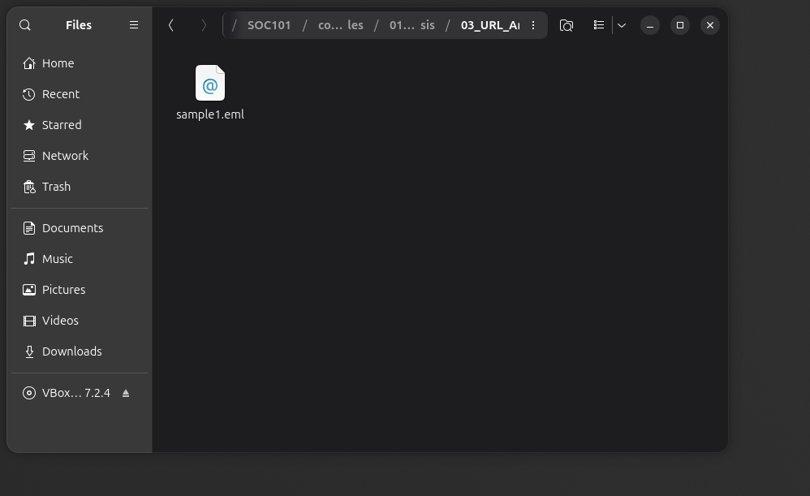

*The same `sample1.eml` from Part 1.*

### 02 Extract the links in CyberChef

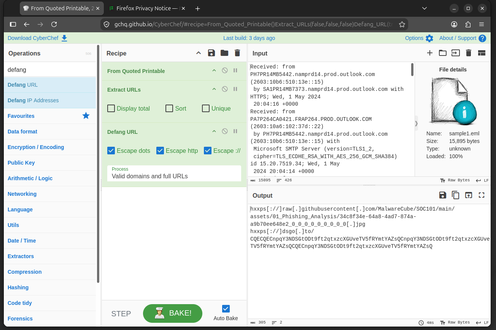

*From Quoted Printable, Extract URLs and Defang URL return the two links: the logo image and the `dsgo.to` short link.*

### 03 Open URLScan.io

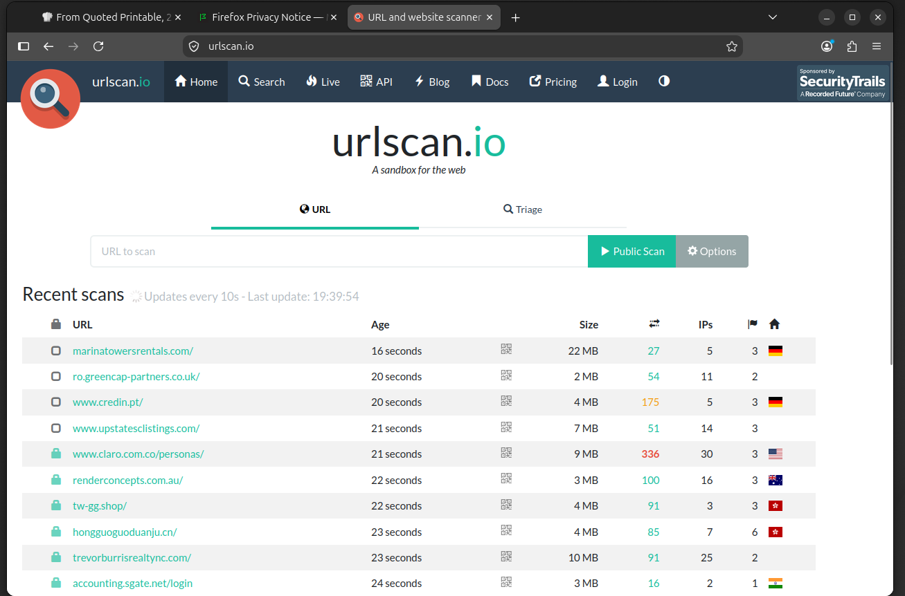

*URLScan.io loads a submitted URL in its own browser and records everything the page does.*

### 04 Copy the link without opening it

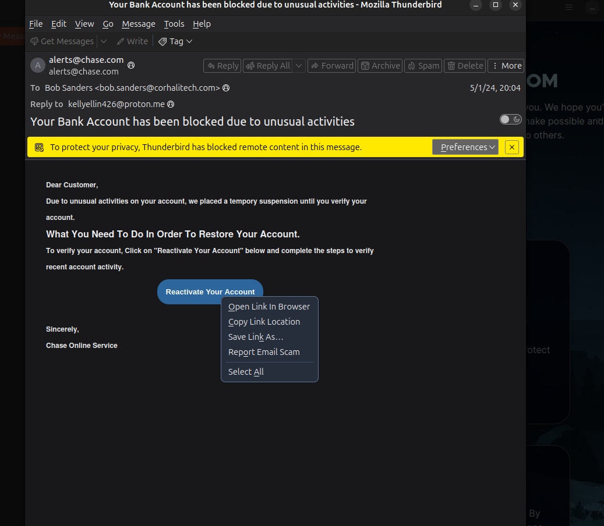

*Right-clicking the "Reactivate Your Account" button and choosing **Copy Link Location** copies the URL without visiting it.*

### 05 Review the URLScan.io summary

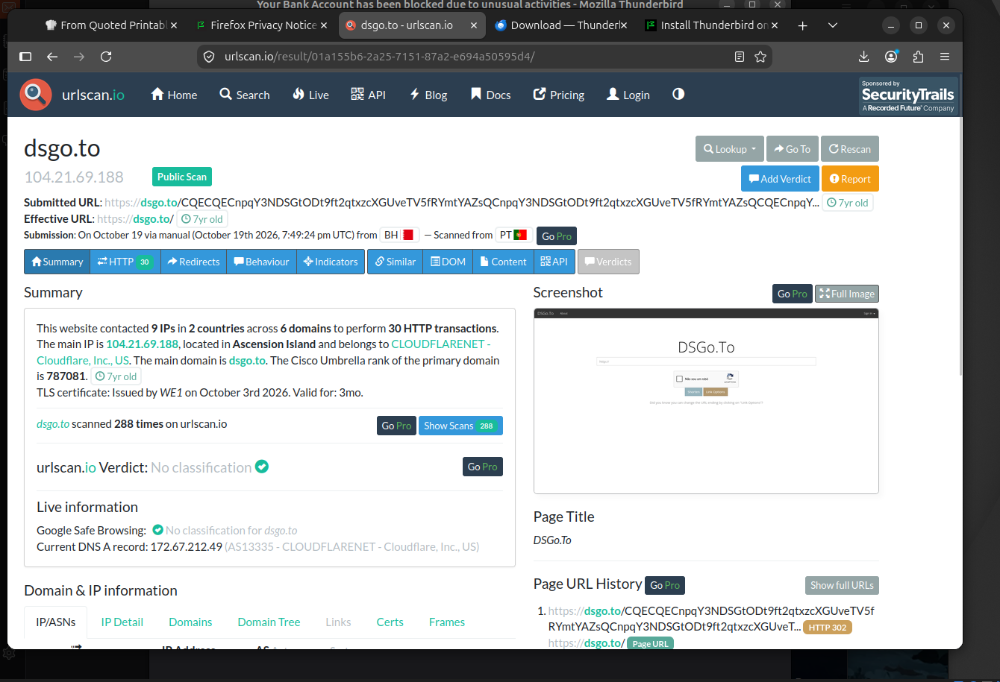

*The short link returned an HTTP 302 to the `dsgo.to` home page (`104.21.69.188`, behind Cloudflare). URLScan.io gives no classification.*

### 06 Inspect cookies and console messages

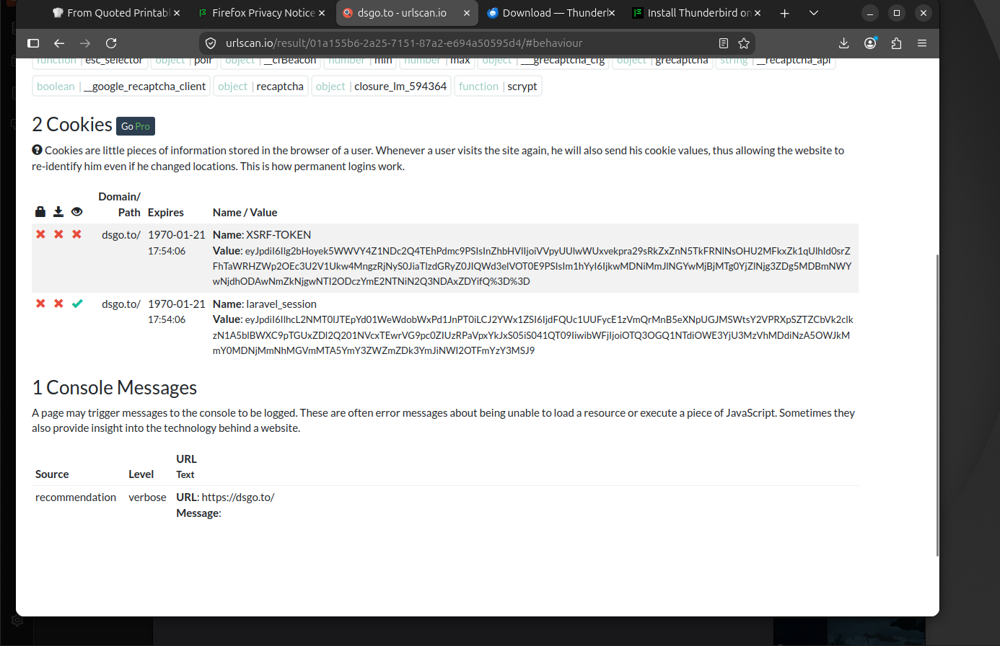

*The page set `XSRF-TOKEN` and `laravel_session` cookies, which shows it runs on the Laravel PHP framework.*

### 07 Review the indicators

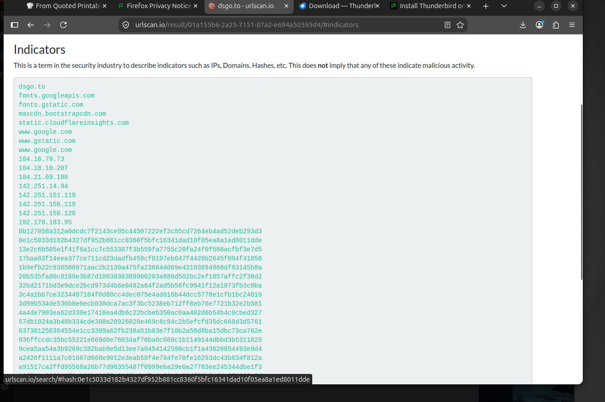

*Domains, IPs and file hashes contacted during the scan. Apart from `dsgo.to`, they are common CDNs and Google services.*

### 08 Check the URL in VirusTotal

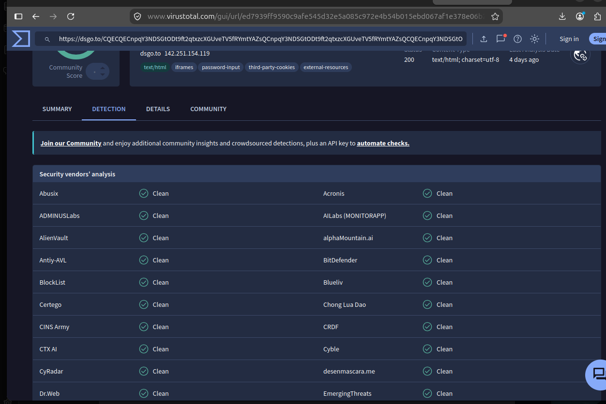

*Every vendor shown reports the URL as clean. VirusTotal tags the page with `iframes`, `password-input` and `third-party-cookies`.*

### 09 Check the domain in URLVoid

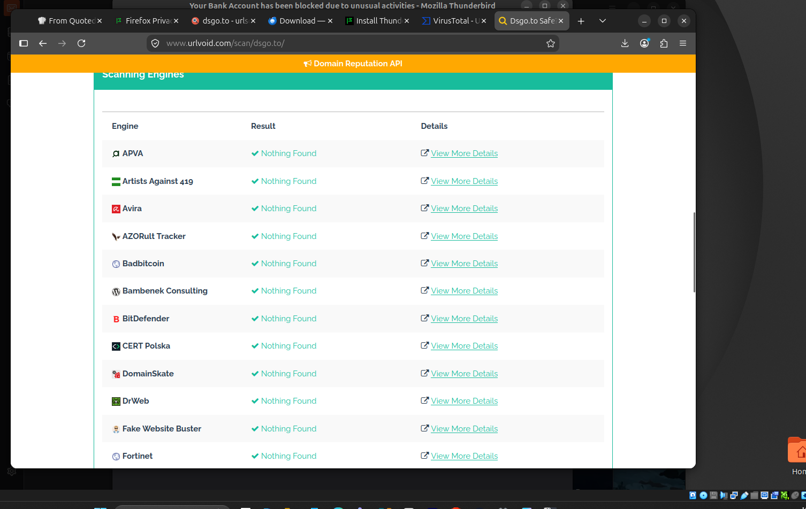

*URLVoid's blocklist engines report "Nothing Found" for `dsgo.to`.*

### 10 Search PhishTank

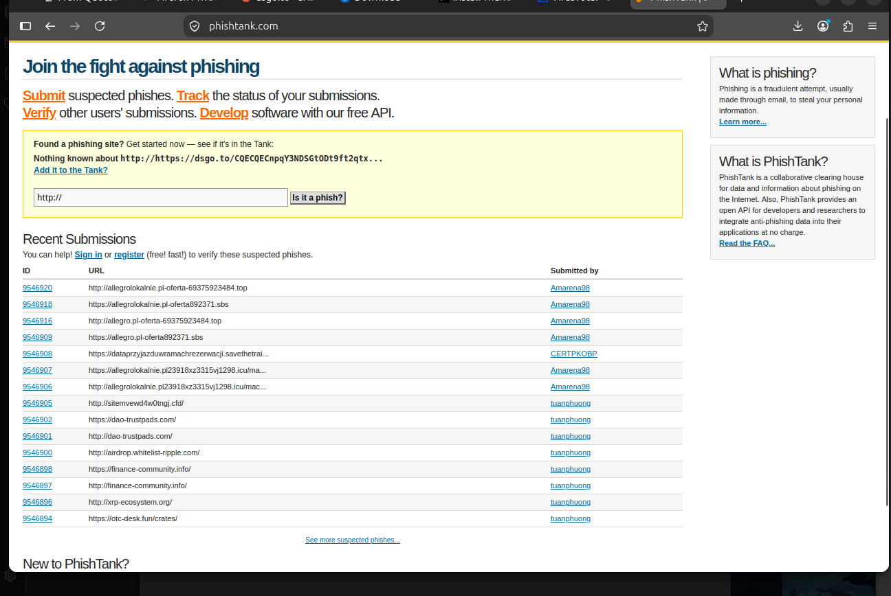

*PhishTank has no record of this URL.*

### 11 Pick a known phish for comparison

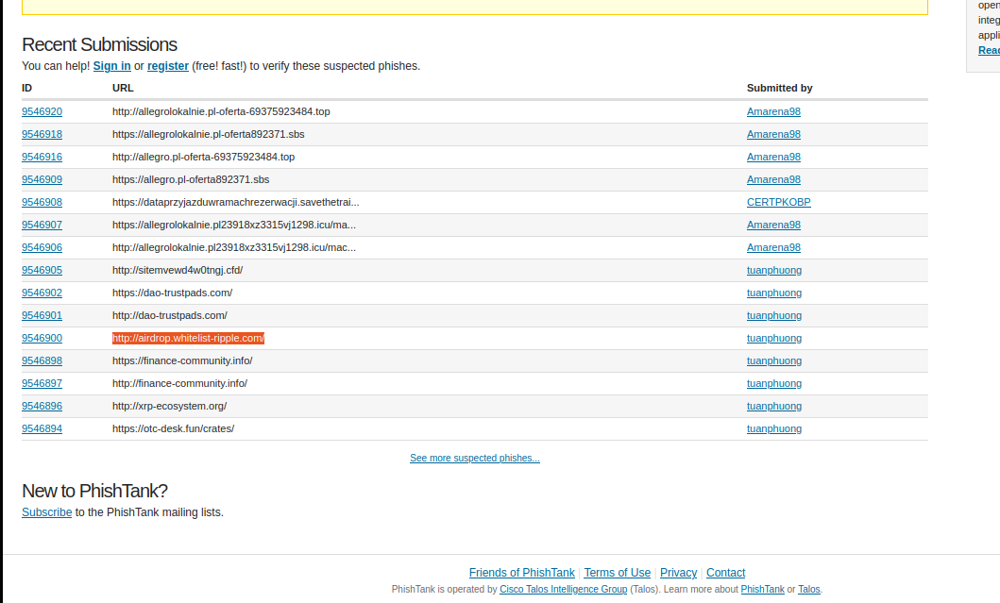

*A recent PhishTank submission, `airdrop.whitelist-ripple.com`, is chosen to see what a confirmed phishing result looks like.*

### 12 Compare with a known phish in VirusTotal

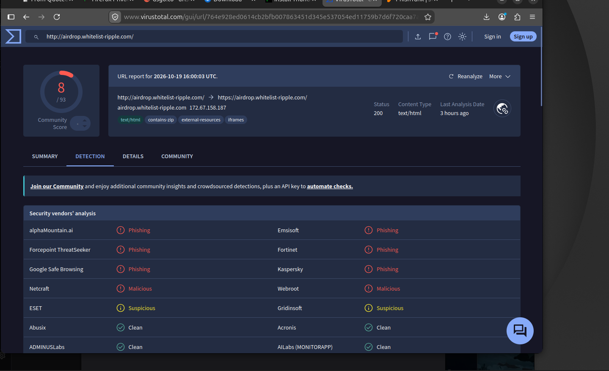

*The reported site is flagged by 8 of 93 vendors, including Google Safe Browsing, Kaspersky and Fortinet.*

### 13 Read the page source safely

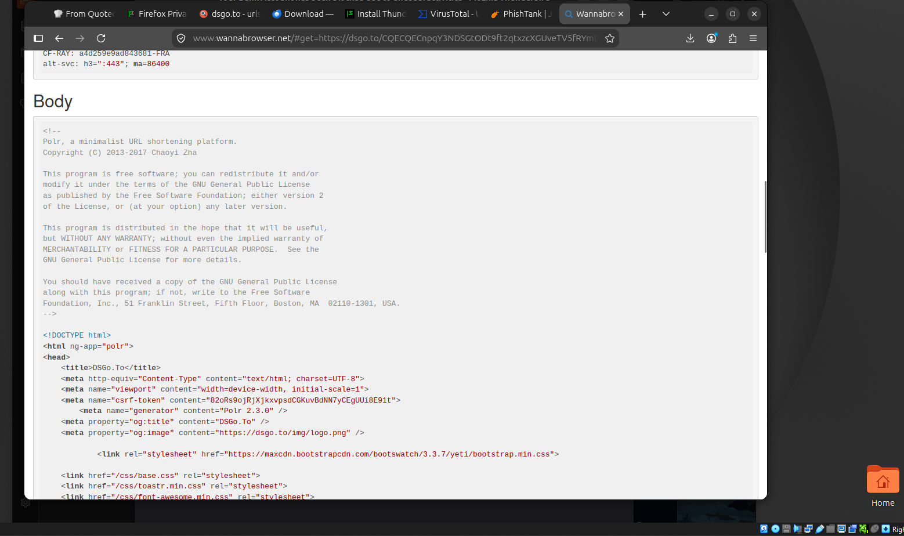

*Wannabrowser fetches the raw HTML. The page is built with **Polr 2.3.0**, an open-source URL shortener.*

### 14 Check Google Safe Browsing

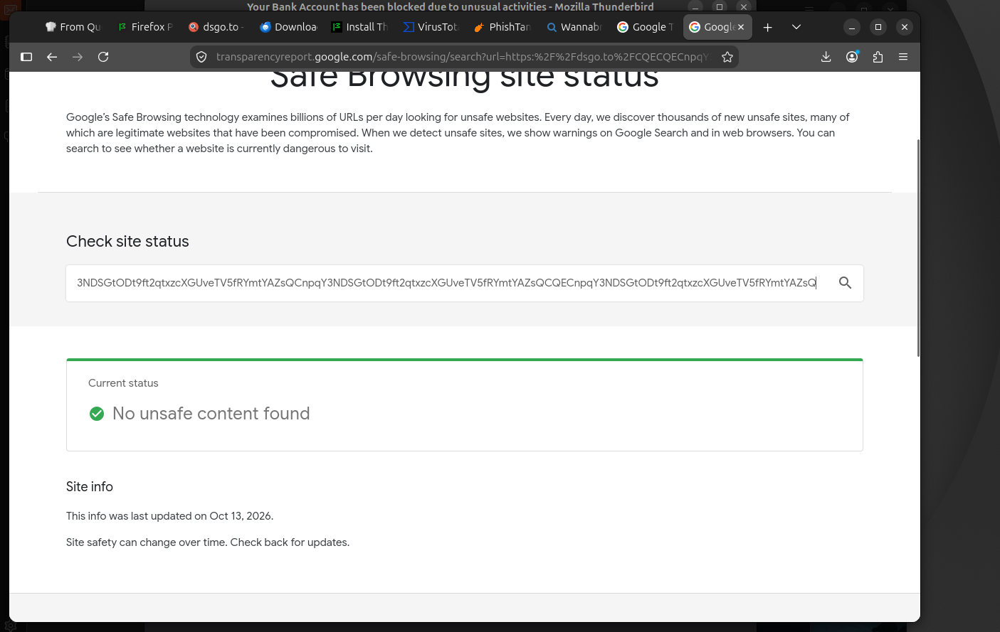

*Google Safe Browsing reports "No unsafe content found" (last updated 13 October 2026).*

## Commands and explanations

| Command or action | What it does |
| --- | --- |
| Right-click, Copy Link Location | Copies a link from the email without opening it |
| URLScan.io, Public Scan | Loads the URL in a sandbox and records redirects, cookies, requests and a screenshot |
| VirusTotal, URL search | Shows verdicts from about 90 vendors |
| URLVoid, domain scan | Checks the domain against blocklists |
| PhishTank search | Looks for community reports of the exact URL |
| Wannabrowser | Downloads the HTML so it can be read without running scripts |
| Google Transparency Report, Safe Browsing site status | Shows Google's current verdict |

## Findings

| Service | Result for `dsgo[.]to` |
| --- | --- |
| URLScan.io | No classification. HTTP 302 to the home page, 9 IPs in 2 countries, Laravel cookies |
| VirusTotal | Clean across the vendors shown |
| URLVoid | Nothing found |
| PhishTank | Not listed |
| Google Safe Browsing | No unsafe content found |

- Every reputation service rated the link clean. The email around it is still clearly phishing: a Chase lookalike sent from Proton Mail, with replies going to a personal address (see Part 1).
- `dsgo.to` is a public Polr URL shortener. By the time it was scanned, the short code only sent visitors to the shortener's home page. The campaign link had probably been removed, or the shortener filters out scanners.
- The comparison with `airdrop.whitelist-ripple.com` (8/93 on VirusTotal) shows what an actively reported phishing page looks like. Reputation depends on someone having reported the URL.

**Verdict:** malicious email. The link cannot be confirmed from reputation alone because the shortener hides the destination, so the message should be handled as phishing.

## Mitigations

- Block or rewrite public URL shorteners in inbound mail, or expand them at the gateway.
- Base the verdict on the whole message (sender, reply address, content and link), not on URL reputation alone.
- Submit confirmed phishing links to PhishTank, Google Safe Browsing and the shortener's abuse contact.
- Record the date of every reputation check, since verdicts change over time.

## Lessons learned

- "Clean" in a reputation service means "nobody has reported it yet", not "safe".
- Shorteners and redirectors are used to dodge scanners. Follow the redirect chain and check where it ends.
- Using several independent tools gives a fuller picture. Comparing against a known-bad URL helps calibrate what the results mean.
- Tools like Wannabrowser and URLScan.io let you see a page's code and behaviour without exposing your own machine.

---

**Previous:** [Phishing Link Analysis, Part 1: Extracting URLs and IOCs](phishing-link-analysis-part-1-url-and-ioc-extraction.md)
