# Email Attachment Analysis: ISO File, VirusTotal and Cisco Talos

*Extracting, validating and corroborating indicators from a suspicious attachment*

| | |
| --- | --- |
| **Format** | Standalone |
| **Category** | Malware analysis, email attachments |

## Objective

Safely extract an ISO attachment from a suspicious invoice email, calculate its hashes, and check them against VirusTotal and Cisco Talos. The attachment was never opened or run.

> **Safety:** All work was done in an isolated lab VM, and the original email was kept unchanged as evidence.

## Tools used

| Tool | Purpose |
| --- | --- |
| Thunderbird | Review the email and attachment name |
| `emldump.py` | List the MIME parts of the email and extract the attachment |
| `sha256sum`, `md5sum` | Calculate file hashes |
| Email IOC Extractor (`eioc.py`) | Extract IPs, URLs, headers and attachment hashes in one pass |
| VirusTotal | Vendor detections, file details, sandbox behaviour and community reports |
| Cisco Talos Intelligence | Second opinion on the file's reputation |

## Methodology

### 01 Locate the sample

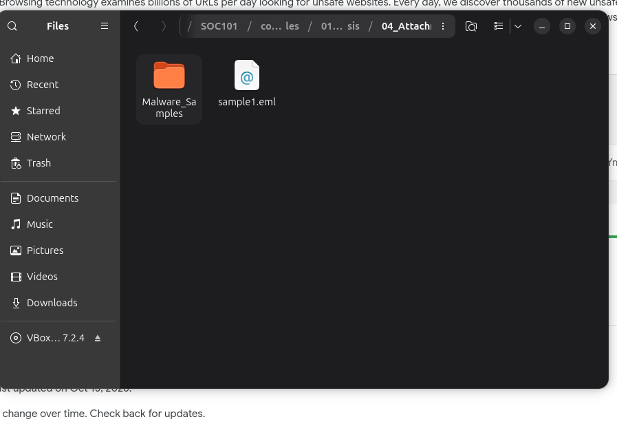

*`sample1.eml` in the `04_Attachment_Analysis` folder.*

### 02 Review the email

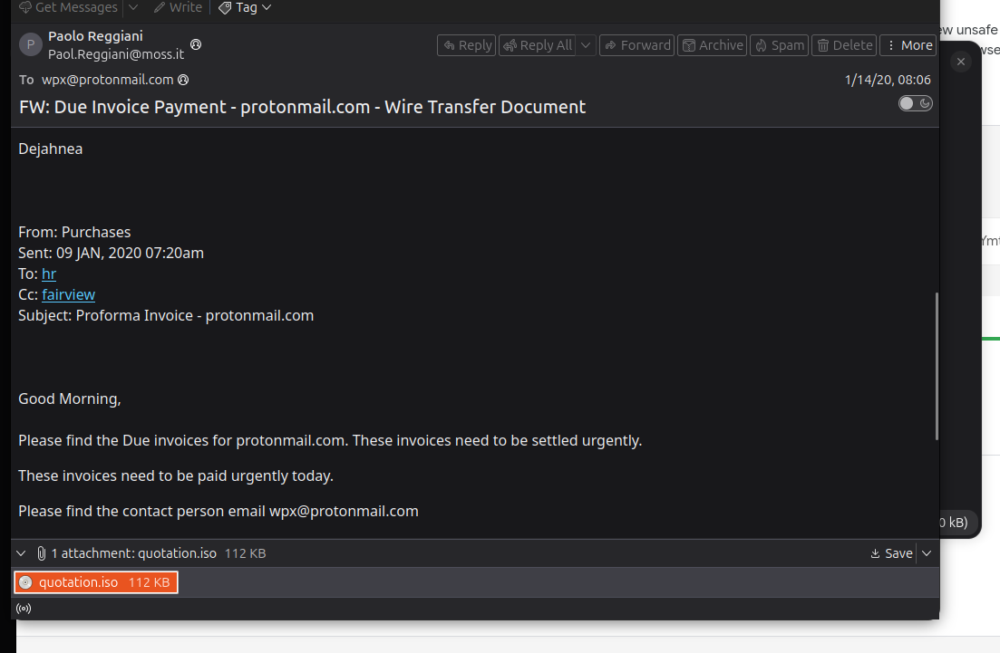

*"FW: Due Invoice Payment ... Wire Transfer Document" pushes the reader to pay urgently. It carries one attachment, `quotation.iso` (112 KB).*

### 03 Save the attachment

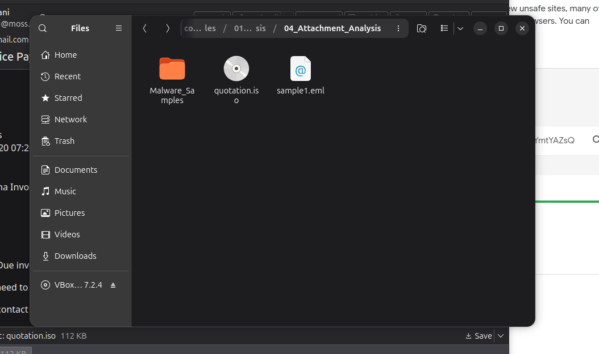

*`quotation.iso` saved next to the email in the analysis folder, without opening it.*

### 04 Add emldump.py to the workspace

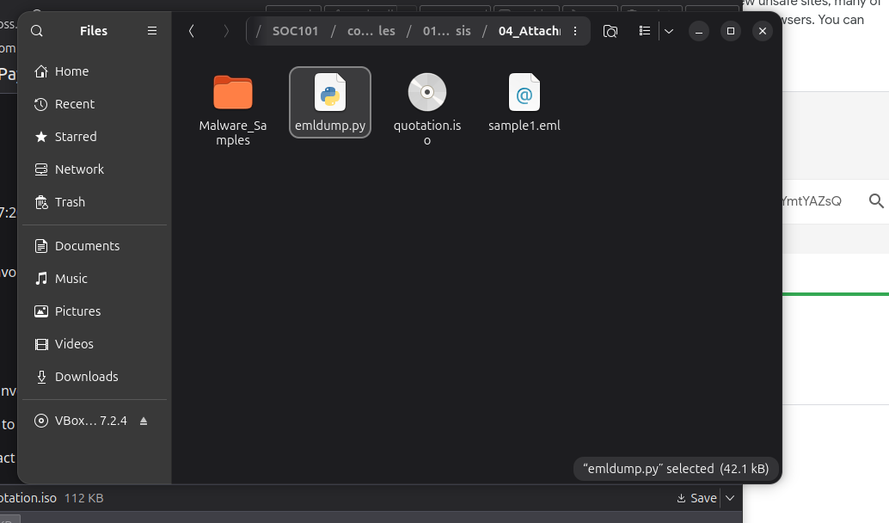

*`emldump.py` copied from the course tools folder into the working directory.*

### 05 List the MIME parts

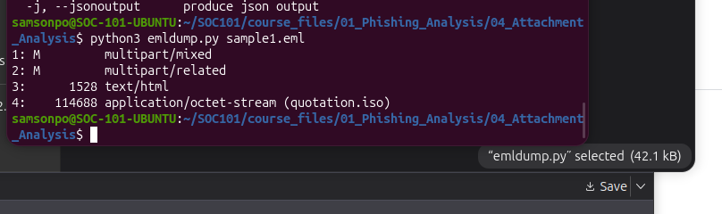

*Part 4 is `application/octet-stream (quotation.iso)`, 114,688 bytes.*

### 06 Extract the attachment from the email

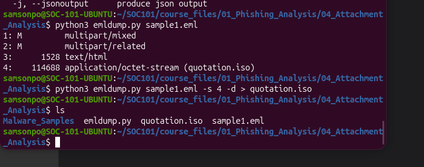

*`-s 4 -d` selects part 4 and writes its decoded bytes to `quotation.iso`.*

### 07 Calculate the hashes

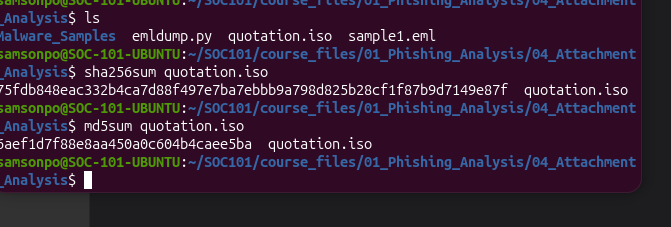

*SHA-256 and MD5 hashes of the extracted file.*

### 08 Cross-check with the IOC Extractor

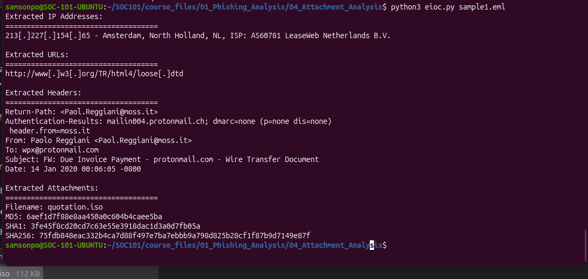

*`eioc.py` reports the same hashes, plus the sender IP and key headers.*

### 09 Search VirusTotal by hash

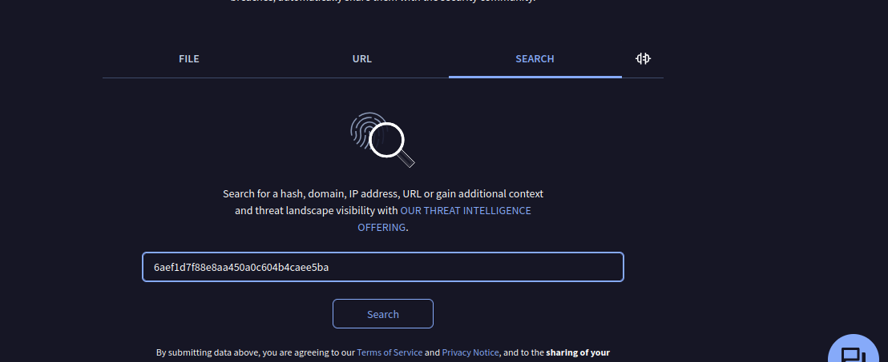

*Searching by hash shows existing results without uploading the file.*

### 10 Review the detections

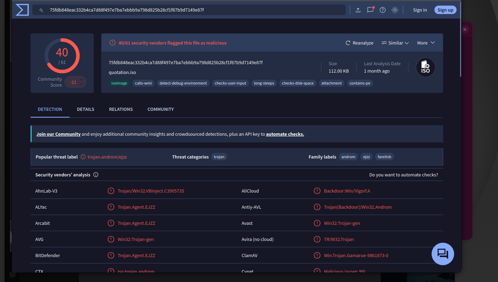

*40 of 61 vendors flag the file as malicious. Popular threat label `trojan.androm/ejzz`, with family labels `androm`, `ejzz` and `fareitvb`.*

### 11 Confirm the file details

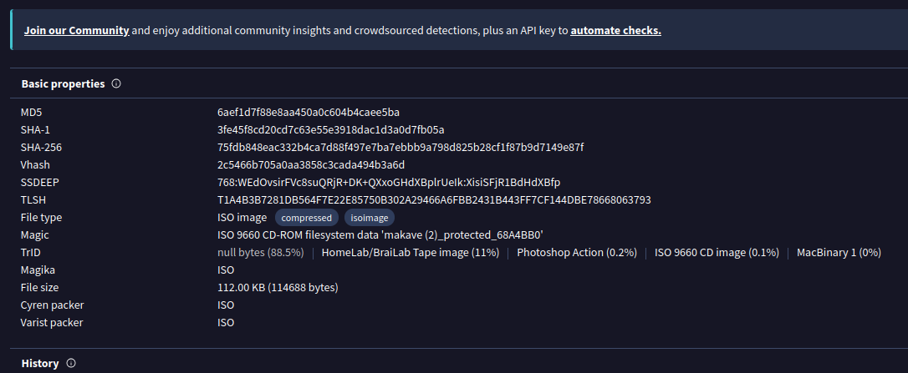

*The MD5, SHA-1 and SHA-256 match the local hashes. The file type is an ISO 9660 image.*

### 12 Review the sandbox behaviour

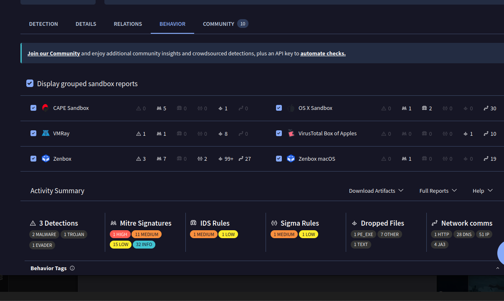

*Sandbox reports from CAPE, VMRay, Zenbox and others. They include 3 detections, 1 high and 11 medium MITRE signatures, a dropped PE executable and network traffic to 51 IPs.*

### 13 Read the community reports

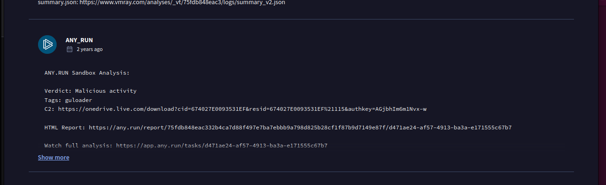

*An ANY.RUN community report marks the sample "Malicious activity" with the tag `guloader`, and lists a OneDrive download link as its command-and-control (C2) source.*

### 14 Cross-check with Cisco Talos

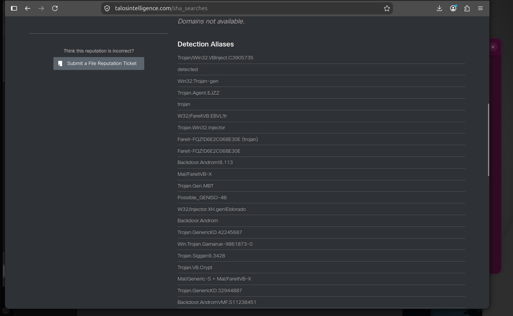

*Talos lists the same detection aliases: Androm backdoor, Fareit, VBInject and generic trojan names.*

## Commands and explanations

| Command | What it does |
| --- | --- |
| Copy `emldump.py` from the course `Tools` folder | Puts the parsing tool next to the sample |
| `python3 emldump.py sample1.eml` | Lists every MIME part with its type, size and file name |
| `python3 emldump.py sample1.eml -s 4 -d > quotation.iso` | Writes the decoded contents of part 4 to a file |
| `sha256sum quotation.iso` / `md5sum quotation.iso` | Calculates the file hashes |
| `python3 eioc.py sample1.eml` | Extracts IPs, URLs, headers and attachment hashes |
| VirusTotal, Search by hash | Looks up existing analysis without uploading the file |
| Talos, File Reputation lookup by SHA-256 | Gives an independent verdict and detection names |

## Findings

| Indicator | Value (defanged) |
| --- | --- |
| Sender | `Paolo Reggiani <Paol.Reggiani@moss[.]it>` |
| Recipient | `wpx@protonmail[.]com` |
| Subject | FW: Due Invoice Payment - protonmail.com - Wire Transfer Document |
| Date | 14 January 2020 |
| Sender IP | `213[.]227[.]154[.]65` (LeaseWeb Netherlands, Amsterdam) |
| DMARC | `none` (the sending domain has no DMARC policy) |
| Attachment | `quotation.iso` (114,688 bytes) |
| MD5 | `6aef1d7f88e8aa450a0c604b4caee5ba` |
| SHA-1 | `3fe45f8cd20cd7c63e55e3918dac1d3a0d7fb05a` |
| SHA-256 | `75fdb848eac332b4ca7d88f497e7ba7ebbb9a798d825b28cf1f87b9d7149e87f` |
| VirusTotal | 40/61, `trojan.androm/ejzz` |
| Families | Andromeda (`androm`), Fareit, GuLoader |

- The lure is a classic invoice-payment scam: an urgent payment request, a forwarded thread, and the recipient's own domain in the subject to make it look personal.
- The ISO format is chosen on purpose. Mounting an ISO lets the executable inside skip the "downloaded from the internet" warning (Mark of the Web) that would apply to a plain `.exe`.
- VirusTotal, its sandbox reports, its community and Cisco Talos all agree: the file is a trojan loader (GuLoader) that delivers Andromeda and Fareit malware.

**Verdict:** malicious. Treat the attachment as unsafe and never open it outside a controlled malware-analysis environment.

## Mitigations

- Block ISO, IMG and VHD attachments at the mail gateway unless there is a business need for them.
- Add the hashes and sender IP to blocklists, and search mailboxes and endpoints for other copies.
- Patch Windows so Mark of the Web is applied to files inside mounted disk images.
- Confirm any payment request through a known contact before acting on it.

## Lessons learned

- Extract the attachment from the `.eml` with a tool, then hash it. Never open it.
- Hashing the file two ways (`sha256sum` and `eioc.py`) and matching against VirusTotal's Details tab confirms you are looking at the same file.
- Searching by hash avoids uploading a sample that might contain sensitive data.
- Agreement across independent sources (vendors, sandboxes, community and Talos) makes the verdict much stronger than any single result.
