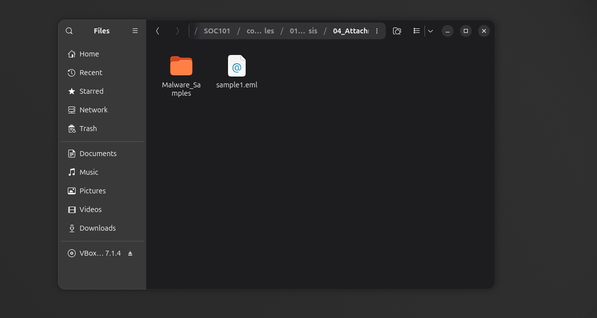
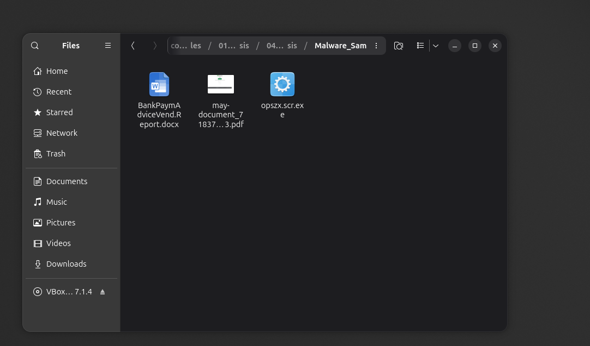
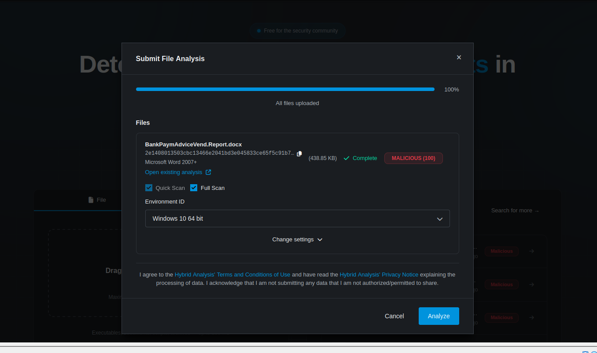
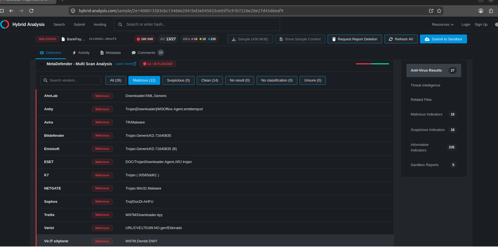
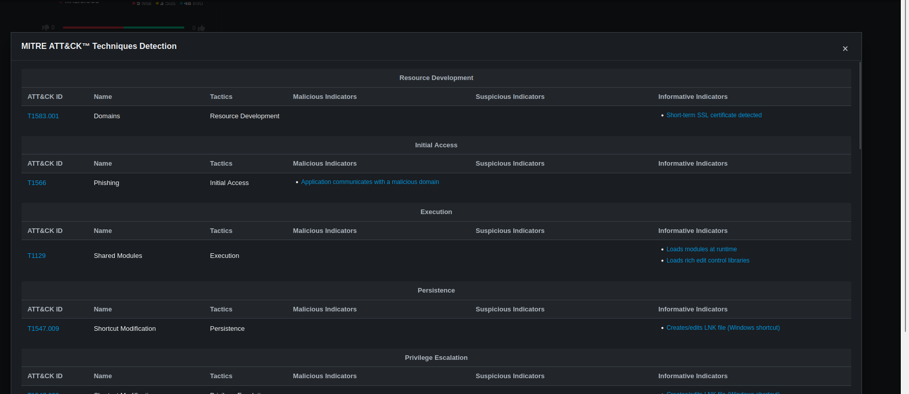
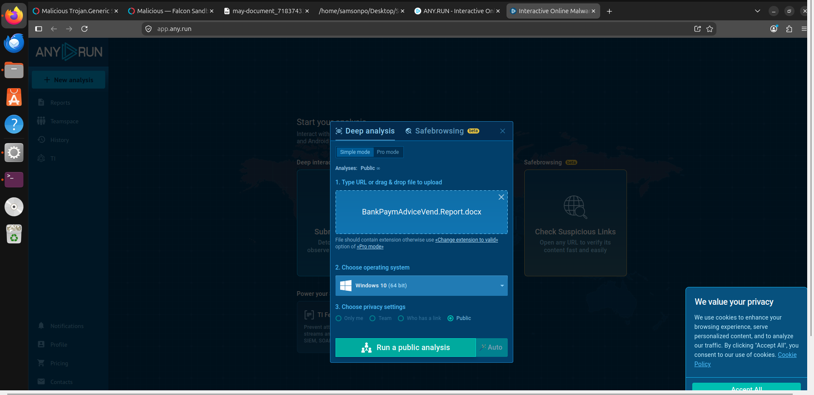
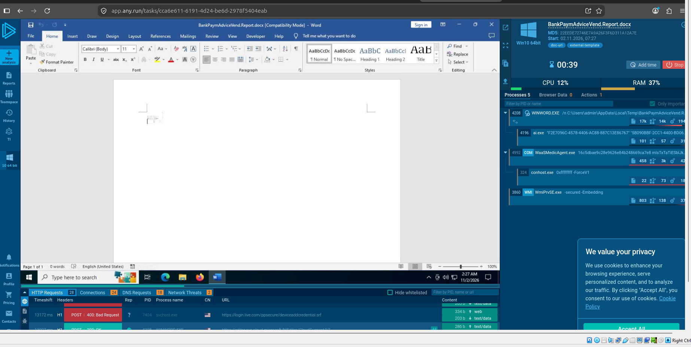
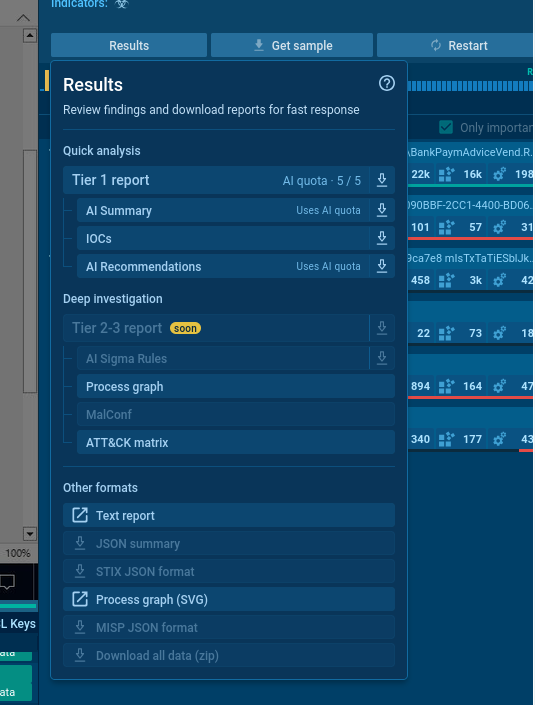
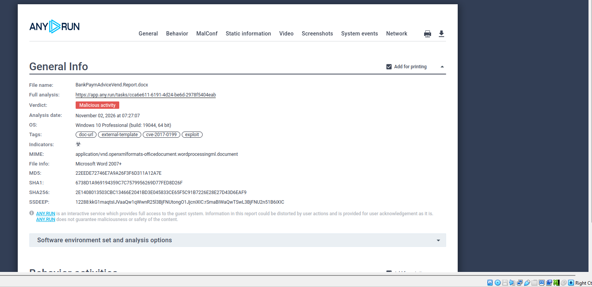
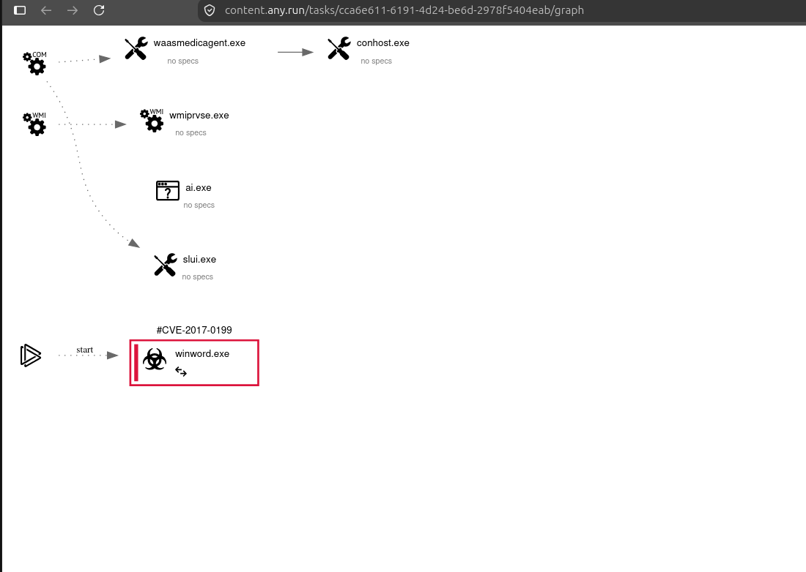

# Malicious Word Document: Hybrid Analysis and ANY.RUN

*Static and dynamic analysis of BankPaymAdviceVend.Report.docx*

| | |
| --- | --- |
| **Format** | Standalone |
| **Category** | Malware analysis, malicious documents |

## Objective

Decide whether `BankPaymAdviceVend.Report.docx`, an attachment from the lab's phishing samples, is malicious, and explain how it works. The file was first checked with Hybrid Analysis (static scanning and threat intelligence), then run in the ANY.RUN sandbox to watch its behaviour safely.

| | |
| --- | --- |
| **File name** | `BankPaymAdviceVend.Report.docx` |
| **File type** | Microsoft Word 2007+ document (.docx) |
| **File size** | 438.85 KB |
| **MD5** | `22EEDE72746E7A9A26F3F6D311A12A7E` |
| **SHA-1** | `6738D1A969194359C7C7579956269D77FED8D26F` |
| **SHA-256** | `2E1408013503CBC13466E2041BD3E045833CE65F5C91B7226E28E27D43D6EAF9` |
| **Hybrid Analysis** | Malicious, threat score 100/100 |
| **ANY.RUN** | Malicious activity |
| **Tags** | `doc-url`, `external-template`, `cve-2017-0199`, `exploit` |
| **Analysis date** | 2 November 2026 |

## Tools used

| Tool | Purpose |
| --- | --- |
| Hybrid Analysis | Antivirus multi-scan, indicators and MITRE ATT&CK mapping |
| ANY.RUN | Interactive sandbox: run the file in an isolated Windows 10 VM and record processes and network traffic |

## Methodology

### 01 Locate the samples

*The `04_Attachment_Analysis` folder holds a `Malware_Samples` folder and `sample1.eml`.*

### 02 Pick the sample

*Three samples: a Word document, a PDF and an executable disguised as a screensaver (`opszx.scr.exe`). This write-up covers the Word document.*

### 03 Submit to Hybrid Analysis

*Submitted for a Windows 10 64-bit environment. An existing analysis for the same hash rates it **MALICIOUS (100)**.*

### 04 Review the antivirus detections

*12 of 26 MetaDefender engines flag the file. The detection names point to a document-based trojan downloader.*

Examples of detection names:

- ESET: `DOC/TrojanDownloader.Agent.ARJ`
- Antiy: `Trojan[Downloader]/MSOffice.Agent.embtempurl` (an embedded template URL)
- Sophos: `Troj/DocDl-AHFU`
- Varist: `URL/CVE170199.NO.gen!Eldorado` (linked to CVE-2017-0199)

Across all engines the report shows 13/27 antivirus detections, with 16 malicious, 18 suspicious and 235 informative indicators.

### 05 Review the MITRE ATT&CK mapping

*The techniques Hybrid Analysis matched to the sample's behaviour.*

| ID | Technique | Tactic | Indicator |
| --- | --- | --- | --- |
| T1566 | Phishing | Initial Access | Communicates with a malicious domain (the key malicious indicator) |
| T1583.001 | Domains | Resource Development | Short-lived SSL certificate |
| T1129 | Shared Modules | Execution | Loads modules and rich edit libraries at runtime |
| T1547.009 | Shortcut Modification | Persistence, Privilege Escalation | Creates or edits a Windows shortcut (LNK) file |

### 06 Submit to ANY.RUN

*Submitted in Simple mode to a Windows 10 (64-bit) VM as a public analysis.*

### 07 Watch it run

*Word shows an almost blank page, a decoy while the real content loads from elsewhere. ANY.RUN tags the run `doc-url` and `external-template` and records 28 HTTP requests, 24 connections, 18 DNS requests and 2 network threats.*

### 08 Open the results

*The Results panel offers IOCs, the ATT&CK matrix, a process graph and a full text report.*

### 09 Read the text report

*Verdict "Malicious activity", tags `cve-2017-0199` and `exploit`, and the file hashes recorded above.*

### 10 Read the process graph

*`winword.exe` is flagged as malicious and labelled CVE-2017-0199. The other processes are normal Windows and Office components started through COM and WMI.*

## Commands and explanations

| Action | What it does |
| --- | --- |
| Hybrid Analysis, Submit File (Windows 10 64-bit) | Runs antivirus engines and static checks, or returns an existing report for the same hash |
| Hybrid Analysis, MITRE ATT&CK view | Maps detected behaviour to ATT&CK techniques |
| ANY.RUN, New analysis (Simple mode, Windows 10 64-bit, Public) | Opens the file in an isolated VM and records processes, network traffic and files |
| ANY.RUN, Results, Text report | Gives the verdict, tags and hashes in one page |
| ANY.RUN, Process graph | Shows which process started which, with malicious processes highlighted |

## Findings

- `BankPaymAdviceVend.Report.docx` is a malicious Word document disguised as a bank payment advice.
- When opened, it uses **remote template injection**: the document carries a link to an external template, and Word downloads it automatically. This technique is associated with exploitation of **CVE-2017-0199**, a remote code execution flaw in Microsoft Office.
- Hybrid Analysis (score 100/100) and ANY.RUN (Malicious activity) reached the same verdict. Several antivirus vendors classify it as a trojan downloader.

## Mitigations

- Block the file hashes and contacted domains on the email gateway and endpoint protection.
- Make sure Microsoft Office is patched against CVE-2017-0199.
- Block Office applications from fetching remote templates and from starting child processes (Attack Surface Reduction rules).
- Treat unexpected payment or invoice attachments as suspicious and report them to the security team.

## Lessons learned

- Static and dynamic analysis complement each other: Hybrid Analysis explains *why* a file is flagged, and ANY.RUN shows *what it does*.
- A blank or near-blank document is a warning sign. The payload is often fetched from somewhere else.
- Searching for an existing report by hash first saves time and avoids uploading the sample again.
- Public sandbox submissions are visible to everyone. Never upload files that may contain sensitive company data.
