# tcpdump, Part 1: Capturing and Filtering Live Traffic

*Interfaces, netcat, a local web server, host and source filters*

| | |
| --- | --- |
| **Format** | Series, part 1 of 3. Continues in [tcpdump, Part 2: The TCP Handshake and a PCAP Investigation](tcpdump-part-2-tcp-handshake-and-pcap-investigation.md) |
| **Category** | Network analysis |
| **Environment** | Ubuntu VM `SOC-101-linux`, interface `enp0s3` (10.0.2.15) |

## Objective

Install tcpdump, find the machine's network interfaces, and capture live traffic generated with netcat, a local Python web server, a browser and curl. Then narrow the capture down with host and source filters.

## Tools used

| Tool | Purpose |
| --- | --- |
| `tcpdump` | Capture and filter packets from the command line |
| `ip` | List interfaces and IP addresses |
| `nc` (netcat) | Open a simple TCP listener and client |
| `python3 -m http.server` | Serve a directory over HTTP |
| `curl` and Firefox | Generate web traffic |

## Methodology

### 01 Install tcpdump

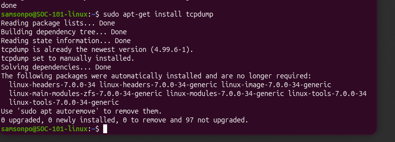

*tcpdump was already at the newest version (4.99.6), so nothing changed.*

### 02 List the network interfaces

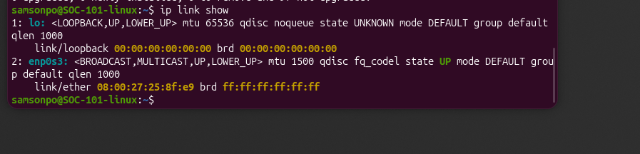

*`ip link show` lists the loopback interface `lo` and the Ethernet interface `enp0s3`, which is UP.*

### 03 List the interfaces tcpdump can use

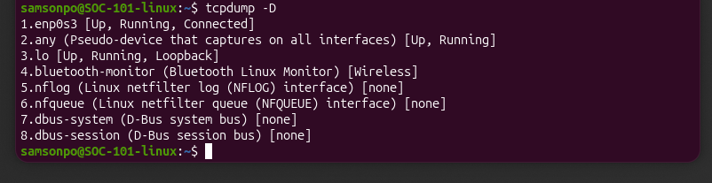

*`tcpdump -D` shows `enp0s3` as Up, Running and Connected. The special `any` device captures on all interfaces at once.*

### 04 Start a capture

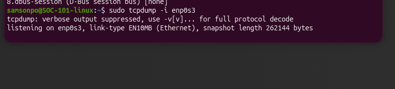

*`sudo tcpdump -i enp0s3` listens on the Ethernet interface.*

### 05 Start a netcat listener

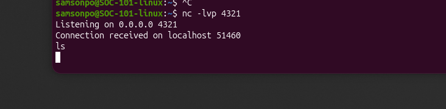

*`nc -lvp 4321` listens on port 4321 and receives a connection from localhost.*

### 06 Connect from a second terminal

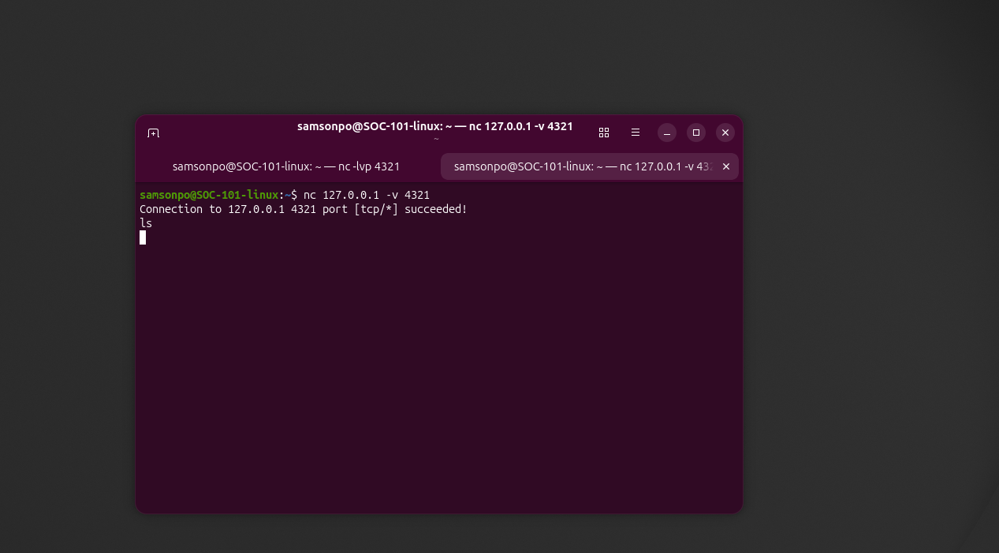

*`nc 127.0.0.1 -v 4321` connects to the listener.*

### 07 Send a message

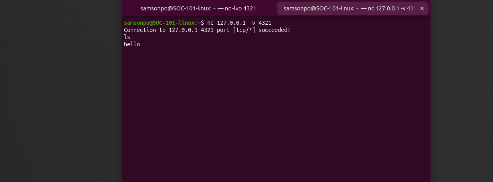

*Typing `hello` in the client...*

### 08 Receive the message

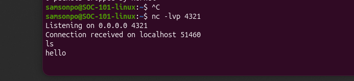

*...delivers it to the listener.*

> **Note:** Traffic to `127.0.0.1` travels over the loopback interface `lo`, not `enp0s3`, so this capture did not record it. Part 2 captures the same kind of session with `sudo tcpdump -i lo`.

### 09 Start a web server on port 80

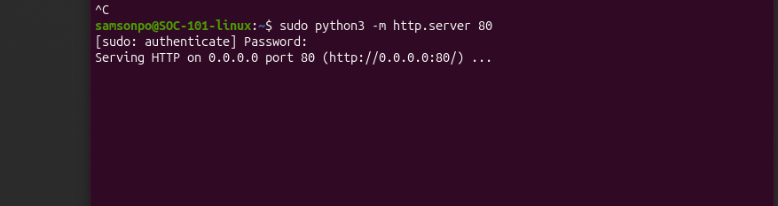

*`sudo python3 -m http.server 80`. Ports below 1024 need root.*

### 10 Restart it on port 8000

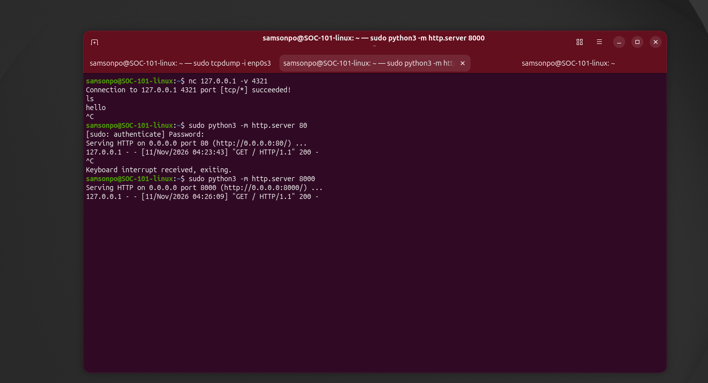

*The server log shows each `GET /` answered with status 200.*

### 11 Request the page with curl

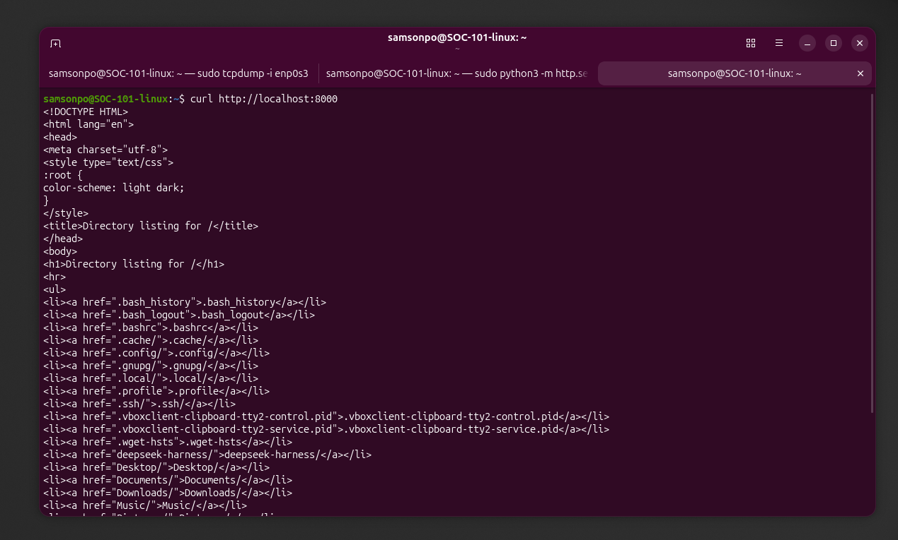

*`curl http://localhost:8000` returns the directory listing as HTML.*

### 12 Observe background traffic

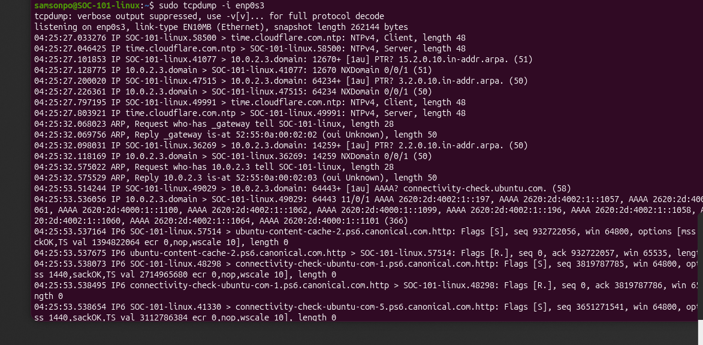

*With no user activity, the capture still shows NTP sync with `time.cloudflare.com`, reverse DNS (PTR) lookups, ARP requests for the gateway and Ubuntu connectivity checks.*

### 13 Filter on one host

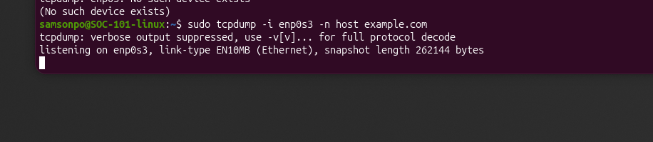

*`sudo tcpdump -i enp0s3 -n host example.com` shows only traffic to and from that site. `-n` keeps raw IP addresses.*

### 14 Load the site in the browser

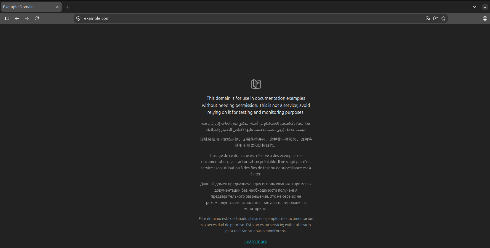

*Opening `example.com` to generate matching traffic.*

### 15 Read the filtered packets

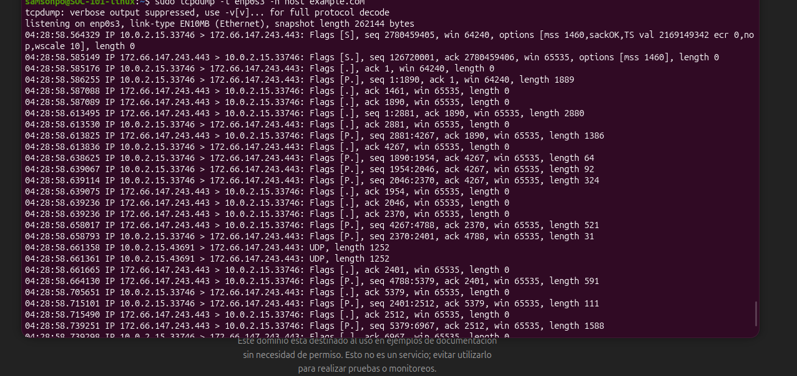

*10.0.2.15 opens a TCP connection to 172.66.147.243 on port 443 with the three-way handshake (`[S]`, `[S.]`, `[.]`), then the encrypted HTTPS exchange.*

### 16 Confirm the machine's IP address

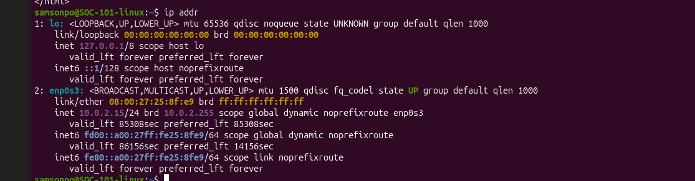

*`ip addr` shows `enp0s3` as 10.0.2.15/24, matching the source address in the capture.*

### 17 Filter on the source address

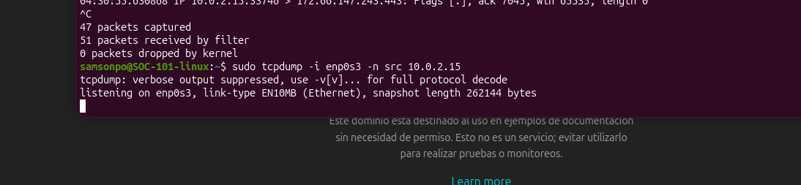

*The previous capture ended with 47 packets captured and 0 dropped. A new capture with `src 10.0.2.15` keeps only outbound packets.*

### 18 Generate outbound traffic

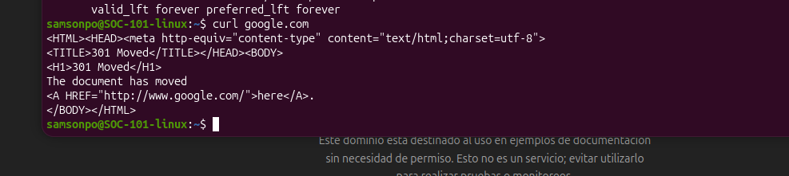

*`curl google.com` gets a 301 redirect to `www.google.com`.*

### 19 Read the outbound packets

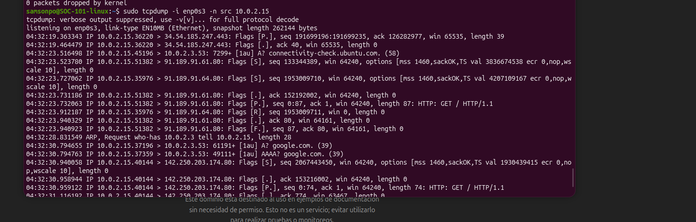

*Only outbound packets: the DNS queries for `google.com`, the TCP handshake, and `GET / HTTP/1.1` to 142.250.203.174 on port 80.*

## Commands and explanations

| Command | What it does |
| --- | --- |
| `sudo apt-get install tcpdump` | Installs tcpdump |
| `ip link show` | Lists network interfaces and their state |
| `tcpdump -D` | Lists the interfaces tcpdump can capture on |
| `sudo tcpdump -i enp0s3` | Captures on one interface |
| `nc -lvp 4321` | Starts a netcat listener on port 4321 (`-l` listen, `-v` verbose, `-p` port) |
| `nc 127.0.0.1 -v 4321` | Connects to the listener |
| `sudo python3 -m http.server 80` | Serves the current directory over HTTP on port 80 |
| `curl http://localhost:8000` | Requests a page from the command line |
| `sudo tcpdump -i enp0s3 -n host example.com` | Captures traffic to or from one host, without name resolution |
| `ip addr` | Shows each interface's IP address |
| `sudo tcpdump -i enp0s3 -n src 10.0.2.15` | Captures only packets sent from one address |

## Findings

- A machine sends traffic even when no one is using it: time sync, DNS, ARP and OS connectivity checks. This is the normal baseline an analyst must be able to recognize.
- Local connections (`127.0.0.1`) never touch the physical interface, so capturing on the wrong interface misses them entirely.
- `host` and `src` filters cut a noisy capture down to the conversation you care about. `-n` keeps the output fast and shows the real IPs.
- Every TCP session in the capture began with the same SYN, SYN-ACK, ACK handshake, whether it was HTTPS to `example.com` or plain HTTP to `google.com`.

## Mitigations

These are defensive takeaways for monitoring rather than fixes for a specific incident:

- Capture on the interface that actually carries the traffic you are investigating (`lo` for local services, `any` when unsure).
- Learn the normal background traffic of each host so unusual connections stand out.
- Prefer HTTPS: the HTTP request to `google.com` was readable in the capture, while the `example.com` session was encrypted.

## Lessons learned

- Always check `tcpdump -D` and `ip addr` before capturing. The interface and address decide what you will see.
- Filters are the most useful skill in tcpdump. Start broad, then narrow with `host`, `src`, `dst` and `port`.
- Ports below 1024 need root, which is why the web server on port 80 needed `sudo`.

---

**Next:** [tcpdump, Part 2: The TCP Handshake and a PCAP Investigation](tcpdump-part-2-tcp-handshake-and-pcap-investigation.md)
