# tcpdump, Part 2: The TCP Handshake and a PCAP Investigation

*Capturing a netcat session, reading a saved capture and tracing a suspicious download*

| | |
| --- | --- |
| **Format** | Series, part 2 of 3. Continues from [tcpdump, Part 1: Capturing and Filtering Live Traffic](tcpdump-part-1-capturing-and-filtering.md), continues in [tcpdump, Part 3: Triaging a PCAP and Finding SSLoad Traffic](tcpdump-part-3-pcap-triage-sslload.md) |
| **Category** | Network analysis |
| **Environment** | Ubuntu VM `SOC-101-linux`, capture file `2021-09-14.pcap` |

## Objective

1. Capture a netcat session on the loopback interface to see how a TCP connection is opened, used and closed.
2. Analyze a saved capture file to find a suspicious download.
3. Investigate that download with WHOIS, CyberChef and VirusTotal.

## Tools used

| Tool | Purpose |
| --- | --- |
| `tcpdump` | Capture live traffic and read saved `.pcap` files |
| `nc` (netcat) | Create a TCP session to observe |
| `grep` | Filter tcpdump output for keywords |
| `whois` | Identify who owns an IP address |
| CyberChef | URL-decode an encoded link |
| VirusTotal | Check the reputation of the download URL |

## Methodology

### Part 1: Capturing a netcat session

#### 01 Open a listener on port 1234

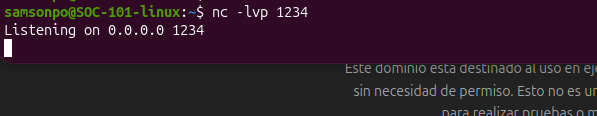

*`nc -lvp 1234` waits for a connection.*

#### 02 Connect from a second tab

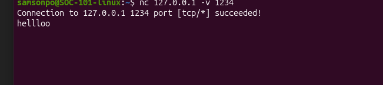

*`nc 127.0.0.1 -v 1234` connects, and a test message is sent.*

#### 03 Capture on the loopback interface

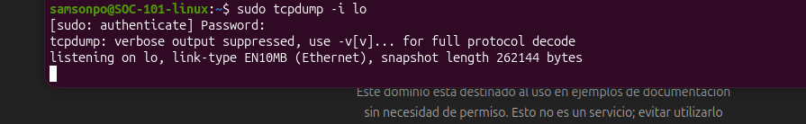

*Both ends are on the same machine, so the traffic uses `lo`: `sudo tcpdump -i lo`.*

#### 04 Send a message

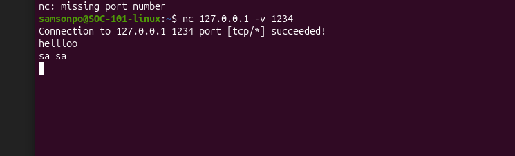

*Sending `sa sa` from the client while the capture runs.*

#### 05 Read the packets

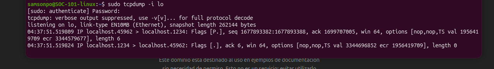

*Two packets: the message and the listener's acknowledgement.*

How to read each line:

| Field | Example | Meaning |
| --- | --- | --- |
| Timestamp | `04:37:51.519809` | When the packet was captured |
| Source > destination | `localhost.45962 > localhost.1234` | The client's random port sending to the listener |
| Flags | `[P.]` / `[.]` | PUSH + ACK (data delivered) / plain ACK |
| Seq and ack numbers | `seq`, `ack` | How TCP keeps the data in order |
| Length | `6` | `sa sa` plus the newline |

#### 06 Close the client

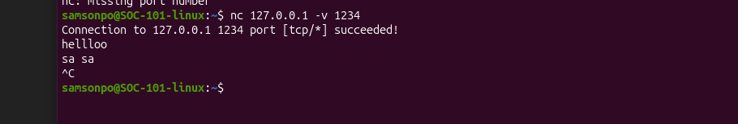

*`Ctrl+C` ends the client session.*

#### 07 The listener exits too

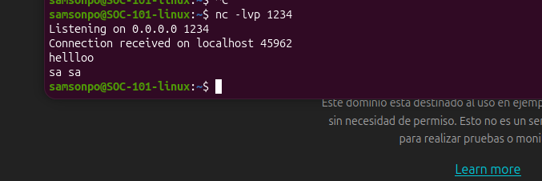

*The connection it was serving has closed, so netcat exits.*

#### 08 Restart the listener

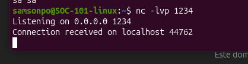

*The new listener receives a connection from port 44762.*

#### 09 Reconnect the client

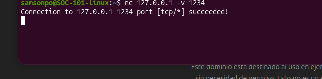

*The client connects again.*

#### 10 Watch the teardown and the new handshake

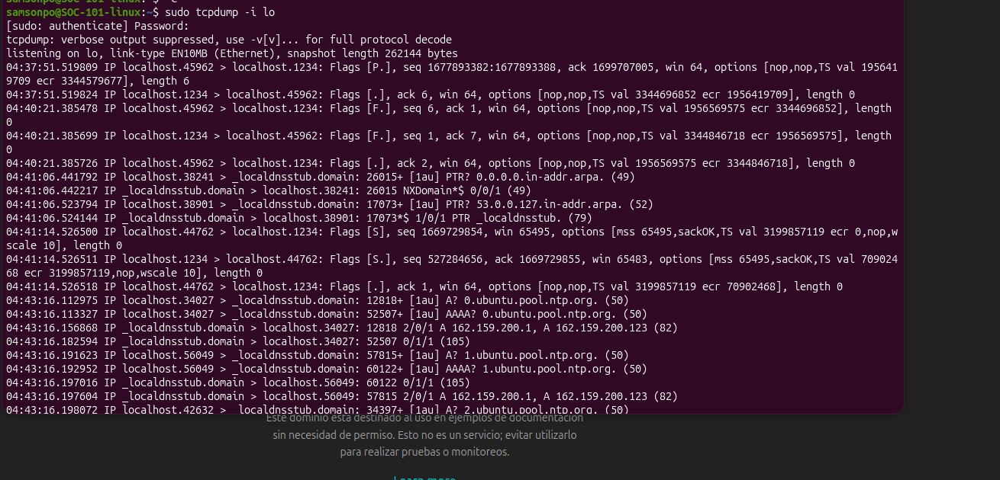

*The first session closes with FIN packets (`[F.]`), and the new session opens with a three-way handshake.*

The **TCP three-way handshake**, all visible in the screenshot above:

1. **SYN** `[S]`: `localhost.44762 > localhost.1234`. The client asks to open a connection.
2. **SYN-ACK** `[S.]`: `localhost.1234 > localhost.44762`. The server agrees.
3. **ACK** `[.]`: `localhost.44762 > localhost.1234`. The connection is established.

### Part 2: Analyzing a saved capture

#### 11 Open the PCAP folder

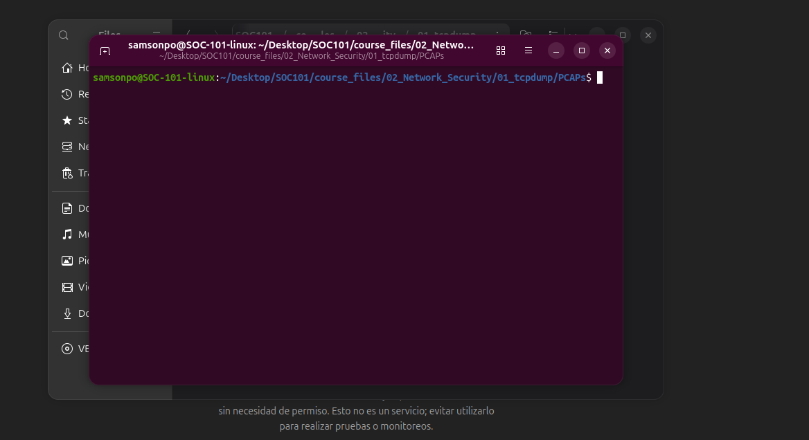

*`cd ~/Desktop/SOC101/course_files/02_Network_Security/01_tcpdump/PCAPs`*

#### 12 Show epoch timestamps

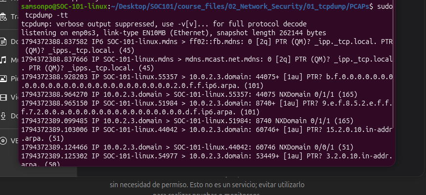

*`-tt` prints each timestamp as Unix epoch seconds, which are easier to sort and compare.*

#### 13 Read the capture file

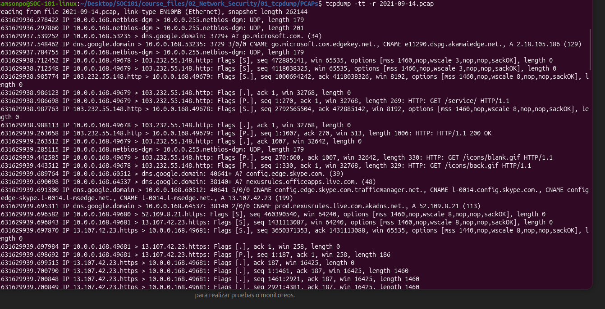

*`tcpdump -tt -r 2021-09-14.pcap` reads packets from the file instead of a live interface.*

#### 14 Count the packets

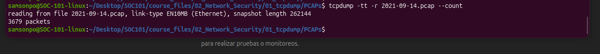

*`--count` reports 3,679 packets.*

#### 15 Identify the internal host

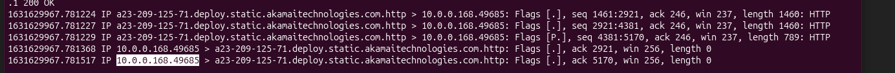

*The host receiving the HTTP responses is **10.0.0.168**, the internal machine in this capture.*

#### 16 Filter HTTP traffic for that host

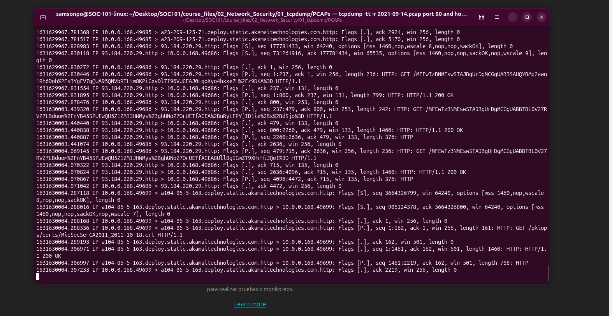

*`port 80 and host 10.0.0.168` keeps only that host's HTTP packets.*

#### 17 List the HTTP requests

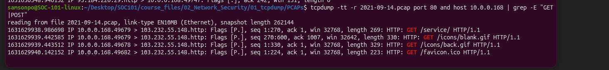

*Piping through `grep -E "GET|POST"` keeps only the request lines.*

#### 18 Spot the suspicious request

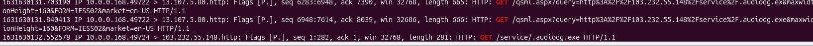

*`GET /service/.audiodg.exe` from 103.232.55.148 stands out.*

`audiodg.exe` is the name of a real Windows audio process that lives in `System32`. It should never be downloaded over plain HTTP from a bare IP address. The leading dot is a common trick to hide a file.

### Part 3: Investigating the indicator

#### 19 WHOIS lookup

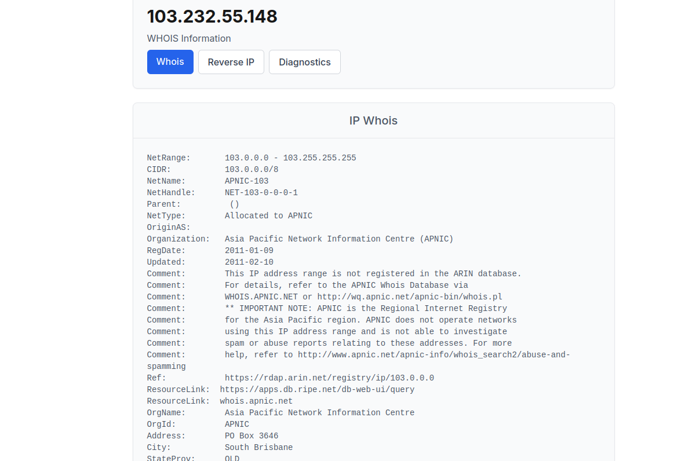

*103.232.55.148 is in a range allocated by APNIC, the Asia-Pacific registry.*

#### 20 Find every reference to the file

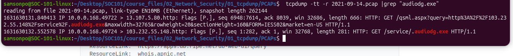

*Two packets mention the file: a search query containing the encoded URL, and the download request itself.*

#### 21 Decode the URL

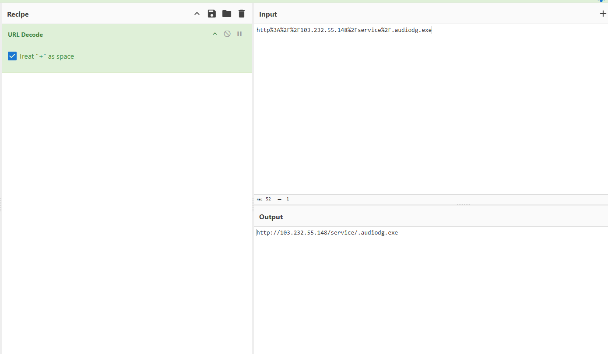

*CyberChef URL Decode turns `http%3A%2F%2F103.232.55.148%2Fservice%2F.audiodg.exe` into the readable download URL.*

#### 22 Check the URL in VirusTotal

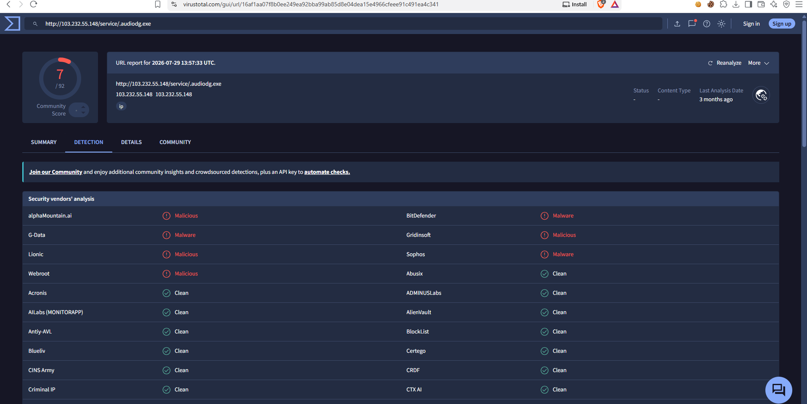

*7 of 92 vendors flag the URL as malicious, including BitDefender, Sophos, G-Data and Webroot.*

#### 23 Print the packet contents

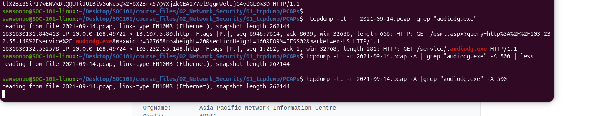

*`-A` prints each payload as ASCII, and `grep -A 500` shows the 500 lines after each match.*

#### 24 Inspect the server's response

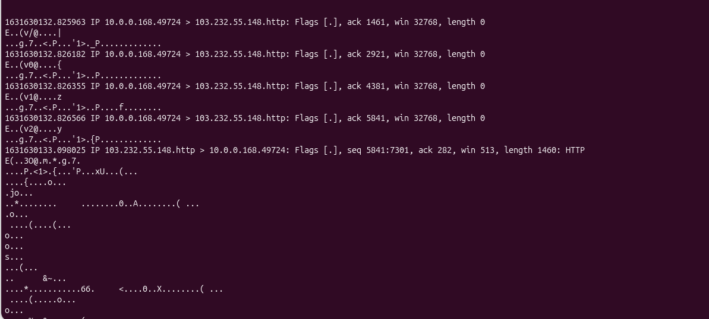

*The payload of the server's response to the download request.*

## Commands and explanations

| Command or option | What it does |
| --- | --- |
| `nc -lvp 1234` | Listens for connections on port 1234 |
| `nc 127.0.0.1 -v 1234` | Connects to the listener |
| `sudo tcpdump -i lo` | Captures on the loopback interface |
| `-tt` | Prints timestamps as Unix epoch seconds |
| `-r 2021-09-14.pcap` | Reads packets from a saved capture file |
| `--count` | Prints only the number of packets |
| `port 80 and host 10.0.0.168` | Keeps HTTP traffic for one host |
| `grep -E "GET\|POST"` | Keeps only HTTP request lines |
| `tcpdump -tt -r 2021-09-14.pcap \| grep "audiodg.exe"` | Finds every packet that mentions the file |
| `-A` | Prints packet payloads as ASCII |
| `grep -A 500` | Shows 500 lines after each match |

## Findings

| Indicator | Value (defanged) |
| --- | --- |
| Internal host | `10.0.0.168` |
| Remote server | `103[.]232[.]55[.]148` (APNIC range) |
| Download URL | `hxxp://103[.]232[.]55[.]148/service/.audiodg.exe` |
| Time | Epoch `1631630132` (14 September 2021, 14:35:32 UTC) |
| VirusTotal | 7/92, malicious |

- Internal host **10.0.0.168** downloaded `/service/.audiodg.exe` over plain HTTP from **103.232.55.148**.
- The file name imitates a legitimate Windows process and is hidden with a leading dot.
- The download URL is flagged as malicious by 7 of 92 vendors on VirusTotal.
- **10.0.0.168 should be treated as potentially compromised** and investigated further.

## Mitigations

- Isolate 10.0.0.168 and investigate it for the downloaded file and any processes it started.
- Block 103.232.55.148 and the download URL at the firewall and proxy.
- Alert on executables downloaded over plain HTTP, especially from bare IP addresses.
- Alert on files that copy Windows system process names (such as `audiodg.exe` or `svchost.exe`) appearing outside `System32`.

## Lessons learned

- The handshake (`[S]`, `[S.]`, `[.]`) and teardown (`[F.]`) flags show exactly when a TCP session starts and ends.
- For a saved capture, start with the totals (`--count`), find the internal host, then filter down to the traffic that matters.
- `grep` on top of tcpdump is a fast way to hunt for file names, methods and keywords in a large capture.
- Epoch timestamps (`-tt`) make it easy to line up events with other logs.

---

**Previous:** [tcpdump, Part 1: Capturing and Filtering Live Traffic](tcpdump-part-1-capturing-and-filtering.md)  
**Next:** [tcpdump, Part 3: Triaging a PCAP and Finding SSLoad Traffic](tcpdump-part-3-pcap-triage-sslload.md)
