# tcpdump, Part 3: Triaging a PCAP and Finding SSLoad Traffic

*Ranking the busiest hosts with text tools, then following one conversation to an SSLoad infection*

| | |
| --- | --- |
| **Format** | Series, part 3 of 3. Continues from [tcpdump, Part 2: The TCP Handshake and a PCAP Investigation](tcpdump-part-2-tcp-handshake-and-pcap-investigation.md) |
| **Category** | Network analysis |
| **Environment** | Ubuntu VM `SOC-101-linux`, capture file `2024-04-18.pcap` |

## Objective

1. Find the busiest hosts in a packet capture using only tcpdump and standard Linux text tools.
2. Narrow in on the most suspicious conversation and read its payload.
3. Pull indicators of compromise out of the traffic.

## Tools used

| Tool | Purpose |
| --- | --- |
| `tcpdump` | Read the saved `.pcap` file and filter packets |
| `cut` | Keep only the source address from each line |
| `sort` / `uniq` | Group, count and rank addresses |
| `grep` | Search packet output and payloads for keywords |

## Methodology

### Part 1: Finding the busiest hosts

#### 01 Open the capture folder in a terminal

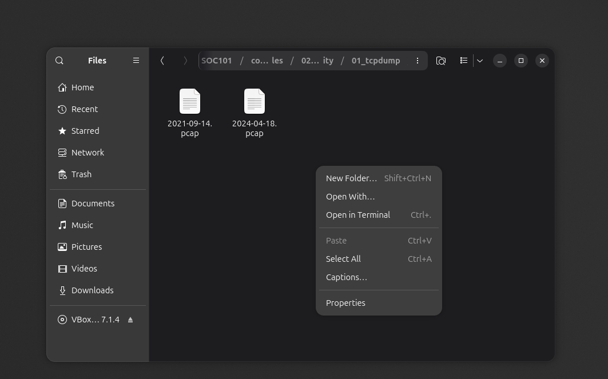

*Right-click inside the PCAP folder and choose **Open in Terminal** (`Ctrl+.`), so the capture can be read by name.*

#### 02 List the TCP packets

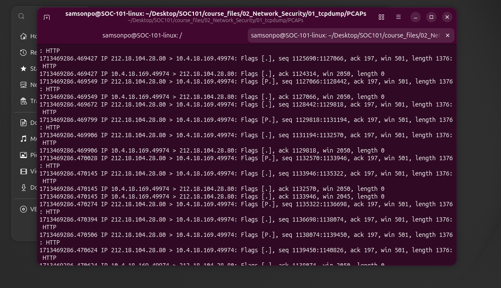

*`tcpdump -tt -r 2024-04-18.pcap -n tcp` reads the file, keeps only TCP and shows raw IPs and ports.*

#### 03 Extract the source address

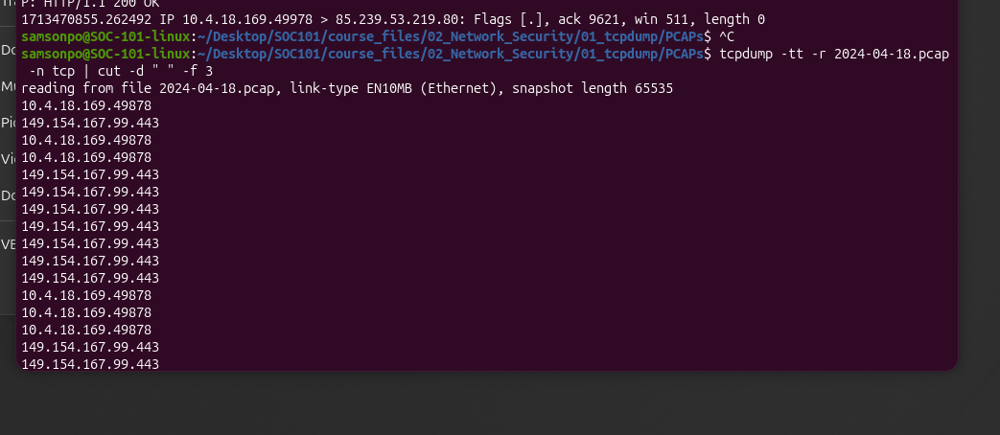

*Each line is space-separated and the third field is the source `IP.port`: `cut -d " " -f 3`.*

#### 04 Drop the port

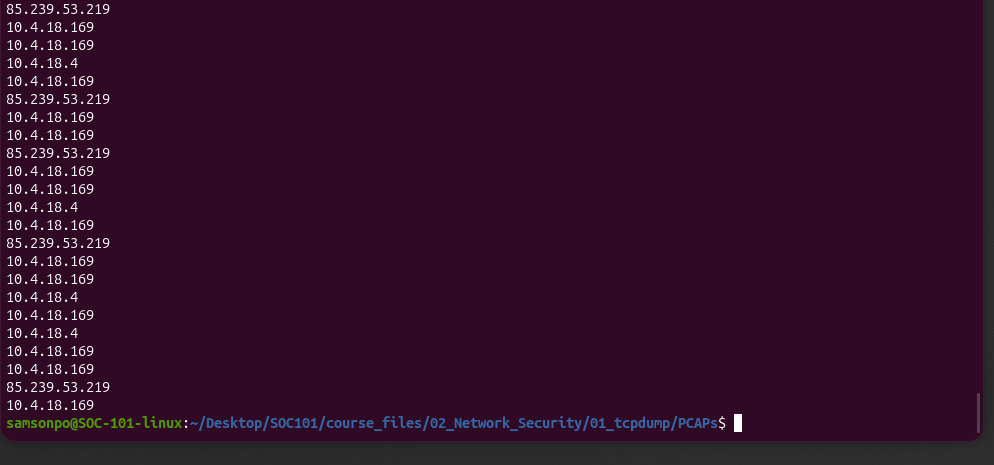

*The port is the fifth dot-separated part, so `cut -d "." -f 1-4` keeps just the IP address.*

#### 05 Sort the addresses

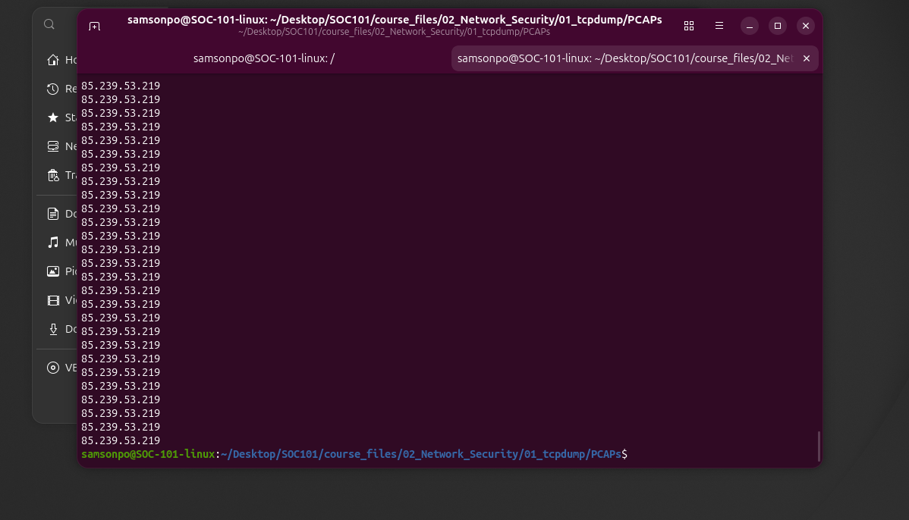

*`sort` puts identical addresses next to each other.*

#### 06 Count each address

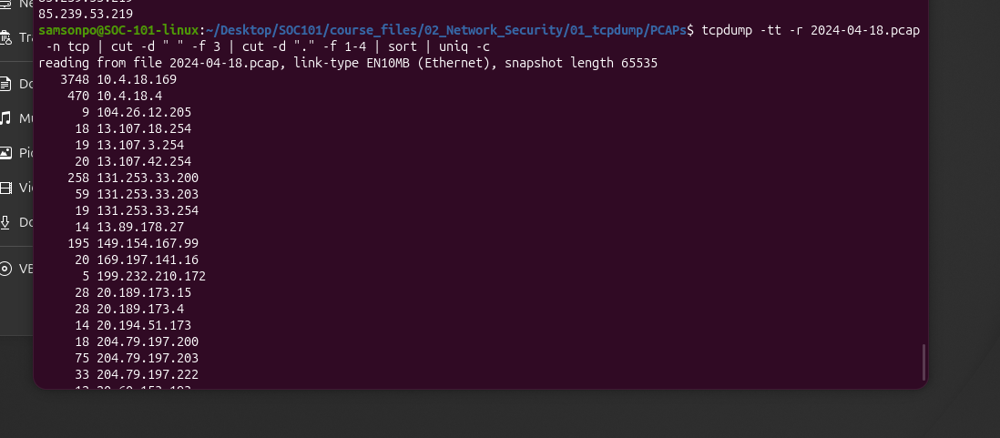

*`uniq -c` collapses duplicates and prints how many packets each address sent.*

#### 07 Rank by packet count

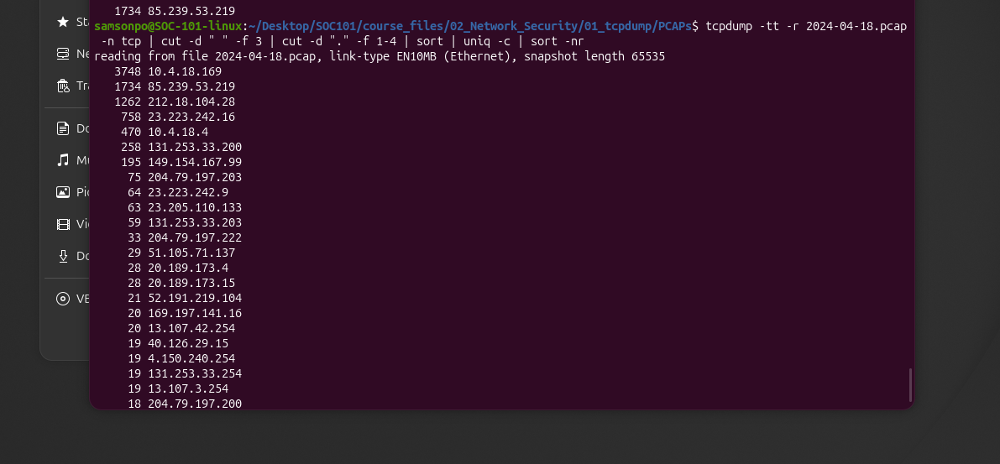

*`sort -nr` ranks numerically from most to fewest packets.*

The full pipeline:

```bash
tcpdump -tt -r 2024-04-18.pcap -n tcp | cut -d " " -f 3 | cut -d "." -f 1-4 | sort | uniq -c | sort -nr
```

The internal host **10.4.18.169** (3,748 packets) and the external address **85.239.53.219** (1,734 packets) are far ahead of everything else, so their conversation is the first thing to investigate.

### Part 2: Following the suspicious conversation

#### 08 Count the packets between the two hosts

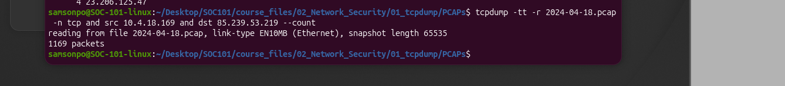

*`tcp and src 10.4.18.169 and dst 85.239.53.219 --count` reports 1,169 packets from the internal host to the external server.*

#### 09 A failed grep along the way

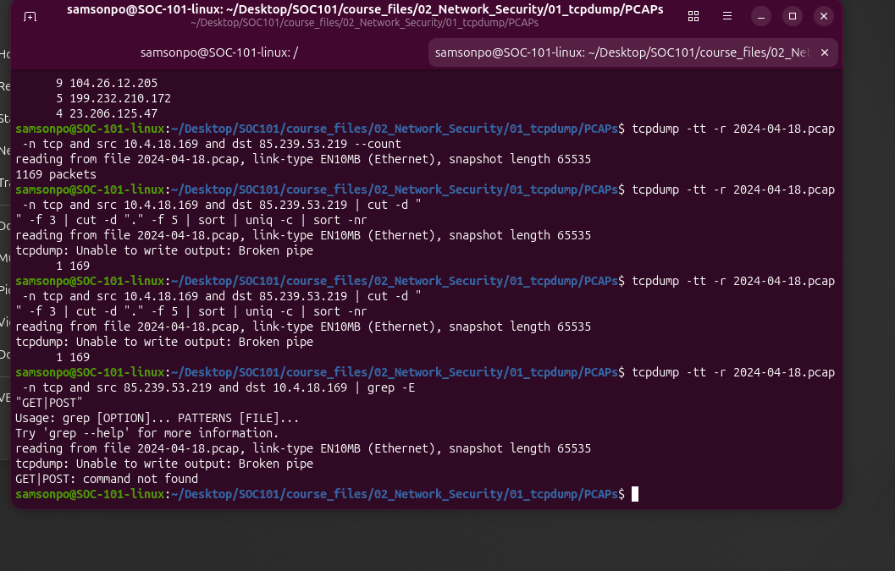

*The quoted `grep` pattern was split across two lines, so the shell ran `GET|POST` as its own command. Keeping the pattern on one line (`grep -E "GET|POST"`) fixes it.*

#### 10 Read the first five packets as ASCII

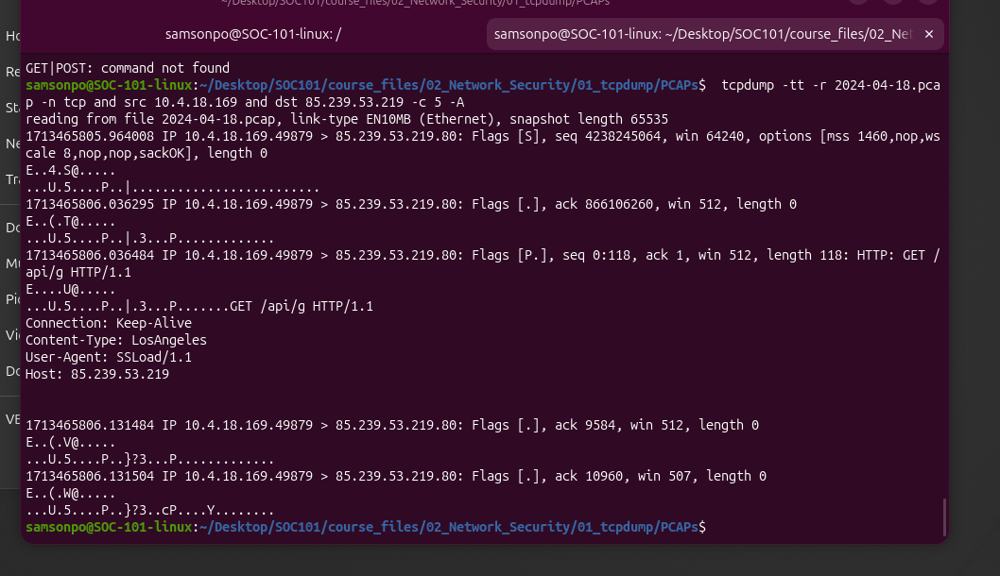

*`-c 5 -A` prints the first five packets with their payloads.*

After the three-way handshake, the host sends `GET /api/g` to 85.239.53.219 with the header `User-Agent: SSLoad/1.1`. That string matches the **SSLoad** malware loader. A real browser would send a Mozilla or Chrome user agent, and the odd `Content-Type: LosAngeles` header is another sign this is not normal browser traffic.

#### 11 Search the payloads for credentials

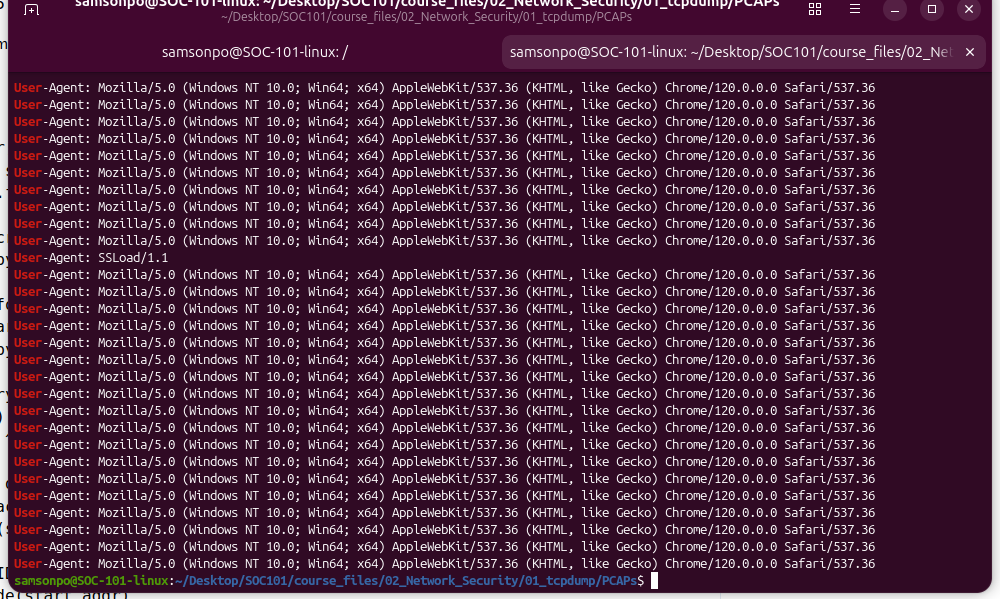

*`host 85.239.53.219 -A | grep -i "user\|pass\|login"` searches every payload to and from the server, ignoring case.*

No credentials appear, but the matches confirm the earlier finding: among the normal Chrome user agents there is a single `SSLoad/1.1` request.

### Part 3: Looking for other indicators

#### 12 Repeated DNS lookups for t.me

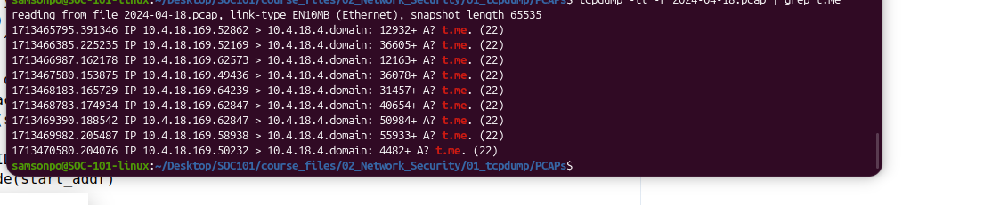

*`grep t.me` shows 10.4.18.169 resolving `t.me` (Telegram) about every 10 minutes. Regular, timed lookups like this are typical of malware checking in, and Telegram is often used to host command-and-control details.*

#### 13 A request for a DLL

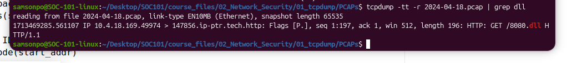

*`grep dll` finds `GET /8080.dll` from 10.4.18.169 to `147856.ip-ptr.tech`.*

#### 14 The DLL is delivered

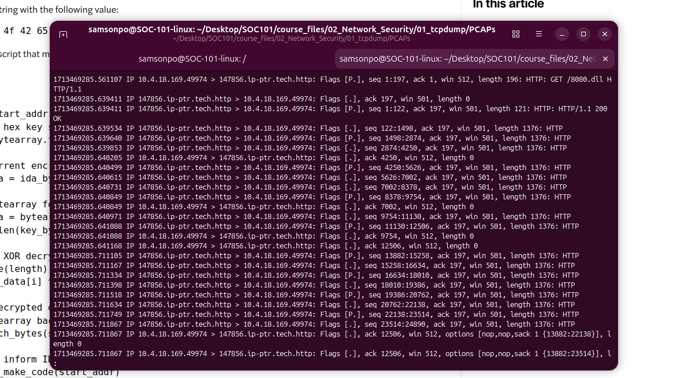

*The server answers `HTTP/1.1 200 OK` and streams a large amount of data back, so the DLL was most likely downloaded.*

## Commands and explanations

| Command or option | What it does |
| --- | --- |
| `-tt` | Prints timestamps as Unix epoch seconds |
| `-r 2024-04-18.pcap` | Reads packets from a saved capture file |
| `-n` | Does not resolve IPs or ports to names |
| `tcp` | Keeps TCP packets only |
| `cut -d " " -f 3` | Keeps the third space-separated field (source `IP.port`) |
| `cut -d "." -f 1-4` | Keeps the first four dot-separated parts (the IP) |
| `sort \| uniq -c \| sort -nr` | Groups, counts and ranks the addresses |
| `src 10.4.18.169 and dst 85.239.53.219` | Keeps traffic in one direction between two hosts |
| `--count` | Prints only the number of matching packets |
| `-c 5` | Stops after five packets |
| `-A` | Prints packet payloads as ASCII |
| `grep -i "user\|pass\|login"` | Case-insensitive search for any of the three words |

## Findings

| Indicator | Value (defanged) |
| --- | --- |
| Infected host | `10.4.18.169` (most active address, 3,748 packets) |
| C2 server | `85[.]239[.]53[.]219`, `HTTP GET /api/g`, 1,169 packets from the host |
| User agent | `SSLoad/1.1` (SSLoad malware loader) |
| First C2 request | Epoch `1713465806` (18 April 2024, 18:43:26 UTC) |
| DNS activity | Repeated A-record lookups for `t[.]me` about every 10 minutes |
| Payload download | `hxxp://147856[.]ip-ptr[.]tech/8080[.]dll`, answered with `200 OK` |
| Download time | Epoch `1713469285` (18 April 2024, 19:41:25 UTC) |

- **10.4.18.169 is infected with the SSLoad loader.** It identifies itself as `SSLoad/1.1` when contacting 85.239.53.219.
- The host keeps looking up `t.me` on a regular schedule, which fits malware beaconing or fetching instructions.
- About an hour after the first C2 request, the host downloaded `8080.dll`, most likely a second-stage payload.

## Mitigations

- Isolate 10.4.18.169 and image it before cleaning, then look for `8080.dll` and any process that loaded it.
- Block 85.239.53.219 and `147856.ip-ptr.tech` at the firewall, proxy and DNS.
- Alert on unusual or non-browser user agents such as `SSLoad/1.1` in proxy logs.
- Alert on DLL and executable downloads over plain HTTP.
- Review whether workstations need to reach `t.me`, and flag regular, timed lookups to it.

## Lessons learned

- `cut`, `sort` and `uniq -c` turn thousands of packets into a ranked list of talkers in one line.
- Start with the busiest pair of hosts, count their packets, then read the first few payloads with `-A`.
- The user agent is a quick, reliable tell: malware often names itself or sends something no browser would.
- Keep shell pipelines on one line. A pattern split across lines becomes a separate command and fails.

---

**Previous:** [tcpdump, Part 2: The TCP Handshake and a PCAP Investigation](tcpdump-part-2-tcp-handshake-and-pcap-investigation.md)
